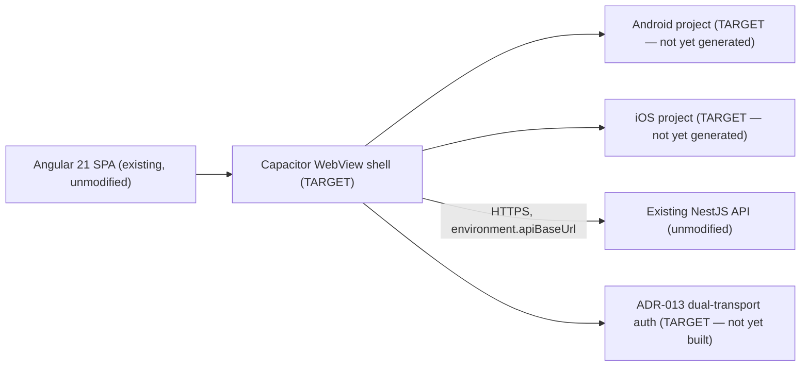
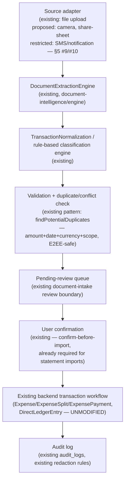
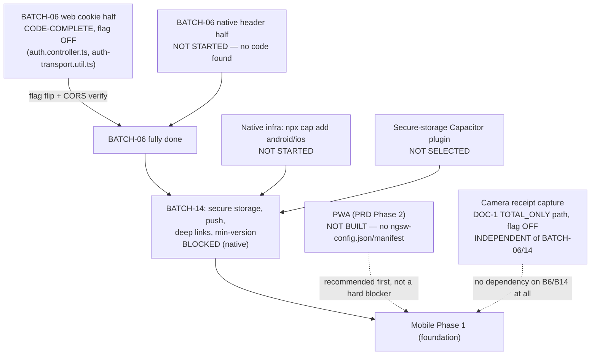

# FinMate - Mobile (Android/iOS via Capacitor) & Transaction Capture (FUTURE)

**Status:** FUTURE architecture proposal only. **Nature:** Documentation
only. This file authorizes no code, dependency installation, native
project creation, schema, migration, API, encryption, or production
change. It does not modify the frozen SRS, Decision Ledger, ADRs,
OpenAPI, data classification matrix, key management model, or any
existing accepted decision. It does not select Capacitor, approve any
feature, or appoint a security/legal reviewer.

**Relationship to existing work — read this before anything below.**
FinMate already has governance material directly on point for most of
what this document covers. This proposal **extends and cross-references**
that material; it does not re-decide it:

- **`BATCH-14` / `W-MOB-01..04`** (`docs/architecture/FINMATE_PRE_IMPLEMENTATION_EXECUTION_PLAN.md` lines 273, 297, 362) — the existing, already-planned batch for secure storage, push, deep links, and minimum-version policy. Status: **BLOCKED (native)**, dependent on `BATCH-06` (auth dual-emit transition, status **READY-WITH-VERIFICATION** — not yet shipped) and "native infra." Fallback if blocked: "fall back to wrap."
- **`ADR-013`** (web refresh-cookie + native secure-storage dual transport) — **Accepted**, decides the target mobile auth-storage architecture already. **Implementation state: TARGET** — current behavior is still the insecure body-token path on every platform (verified below).
- **`ADR-021`** (V1 in-app notifications; OS push deferred) — **Accepted**, already decides that push is deferred until native push infrastructure exists, and that any future push payload must be content-free.
- **`docs/architecture/FINMATE_DOCUMENT_INTELLIGENCE_READINESS.md`** and **`FINMATE_DOCUMENT_INTELLIGENCE_AND_DYNAMIC_TAXONOMY_FUTURE.md`** — an existing, detailed, already-gated pipeline for extracting transactions from uploaded documents (receipts, credit-card statements, and — explicitly — bank statements), built on a real `DocumentExtractionEngine` + classification engine + `TransactionNormalization`. Credit-card/bank-statement extraction is explicitly classified **"NEXT — BLOCKED"** pending counsel (`OQ-03`, vendor/cross-border data transfer) and a MUST-safeguard set (`FUT-004`: never store CVV/PIN/PAN; extract-then-delete-original by default).

**This document does not propose a second, competing transaction-ingestion
pipeline.** Where mobile-specific capture (SMS, notification access) is
discussed below, it is framed as a _possible future source adapter feeding
the existing pipeline_ — and one that is **less mature and more
restricted** than the document-upload pathway that is itself still
blocked. It should not be prioritized ahead of that already-gated, already
-designed work.

---

## 1. Executive Summary

FinMate's web frontend (Angular 21 SPA/PWA) already has **Capacitor
scaffolding present but unused**: `@capacitor/core`/`@capacitor/cli` are
installed and `capacitor.config.ts` exists at the repo root, but **no
Android or iOS native project has ever been generated** (`npx cap add` has
not been run — no `android/`/`ios/` directories exist), **no Capacitor
plugin is imported anywhere in frontend code**, and the PWA half of the
same "mobile-readiness" commit that added Capacitor was **not actually
delivered** (no service worker, no manifest — verified below), despite
being described as done in that commit's message and in `AGENT_RULES.md`.

Capacitor remains the most consistent choice for FinMate given the
existing Nx/Angular monorepo and the fact that the technology stack table
in `AGENT_RULES.md` already names it — but the **existing accepted
architecture (`ADR-013`) has not been implemented yet**, and wrapping the
app in Capacitor today would ship the current, verified-insecure
`localStorage` token storage inside a native shell, which is a materially
different risk profile than the same code running in a browser tab.
**That gap should be closed as part of, not after, any real mobile
shipment** — it is not a new decision, since `ADR-013` already decided the
target architecture; it is unbuilt implementation work (`BATCH-14`/
`BATCH-06`).

Automatic SMS or notification-based transaction capture — the most
ambitious capability requested in the originating product brief — faces
**verified, current, dated platform restrictions** on both Android (Google
Play's SMS/Call Log Permissions policy restricts this to default SMS/
Phone/Assistant handlers or a narrow declared exception) and iOS
(no background-execution mode exists for reading another app's
notifications or incoming messages). It should be scoped, if pursued at
all, as a long-horizon, counsel-reviewed addition **after** the existing
document-upload bank/CC-statement pipeline (`FINMATE_DOCUMENT_INTELLIGENCE_READINESS.md`)
clears its own already-identified gates — not as a parallel, earlier
initiative.

---

## 2. Current-State Evidence (verified this session)

| Area                                                                   | Verified fact                                                                                                                                                                                                                                                                                                                                                                                                                                                                                                                                                                                                    | Source                                                                                                          |
| ---------------------------------------------------------------------- | ---------------------------------------------------------------------------------------------------------------------------------------------------------------------------------------------------------------------------------------------------------------------------------------------------------------------------------------------------------------------------------------------------------------------------------------------------------------------------------------------------------------------------------------------------------------------------------------------------------------- | --------------------------------------------------------------------------------------------------------------- |
| Angular version                                                        | `21.2.0`                                                                                                                                                                                                                                                                                                                                                                                                                                                                                                                                                                                                         | `package.json:90`                                                                                               |
| Package manager/lockfile                                               | npm, `package-lock.json`                                                                                                                                                                                                                                                                                                                                                                                                                                                                                                                                                                                         | repo root                                                                                                       |
| Monorepo/build                                                         | Nx workspace (`nx.json`); CI runs `npx nx run-many -t lint test build` on Node 20                                                                                                                                                                                                                                                                                                                                                                                                                                                                                                                                | `.github/workflows/ci.yml` lines 29-38                                                                          |
| API base URL                                                           | `environment.apiBaseUrl`, not hardcoded (per `AGENT_RULES.md`, confirmed by the `e0599a2` commit migrating 33 hardcoded URLs)                                                                                                                                                                                                                                                                                                                                                                                                                                                                                    | `frontend/src/environments/environment.ts`                                                                      |
| Routing                                                                | `provideRouter(appRoutes)`, default `PathLocationStrategy` (no `withHashLocation`)                                                                                                                                                                                                                                                                                                                                                                                                                                                                                                                               | `frontend/src/app/app.config.ts` lines 6, 27                                                                    |
| **Auth token storage — CURRENT, verified insecure for a native shell** | Both the access token and refresh token are stored in **`localStorage`** (`finmate_token`, `finmate_refresh_token`), read/written directly by `auth.state.ts` and `token-refresh.service.ts`                                                                                                                                                                                                                                                                                                                                                                                                                     | `frontend/src/app/core/auth/auth.state.ts` lines 56-58, 99-101, 170-171, 193-195; `token-refresh.service.ts:35` |
| **Target auth architecture — already decided, not yet built**          | `ADR-013`: web = HttpOnly+Secure+SameSite=Lax cookie; native (Capacitor) = iOS Keychain/Android Keystore via header. **Implementation state: TARGET**; current = body token everywhere.                                                                                                                                                                                                                                                                                                                                                                                                                          | `docs/architecture/adr/ADR-013-dual-transport-auth.md`                                                          |
| Capacitor scaffolding                                                  | `@capacitor/core`/`@capacitor/cli` `^8.4.1` installed; `capacitor.config.ts` present (`appId: app.finmate.app`, `webDir: dist/frontend/browser`) — added in commit `e0599a2`                                                                                                                                                                                                                                                                                                                                                                                                                                     | `package.json:34,95`; `capacitor.config.ts`                                                                     |
| **Native projects — do not exist**                                     | No `android/` or `ios/` directory anywhere in the repo; `npx cap add <platform>` has never been run                                                                                                                                                                                                                                                                                                                                                                                                                                                                                                              | `find . -maxdepth 1 -iname android -o -iname ios` → empty                                                       |
| **Capacitor plugins — none used**                                      | No `@capacitor/*` plugin import exists anywhere in `frontend/src`                                                                                                                                                                                                                                                                                                                                                                                                                                                                                                                                                | repository-wide grep, no hits                                                                                   |
| **PWA — claimed in commit message, not actually delivered**            | Commit `e0599a2`'s message claims "Add @angular/pwa with service worker and manifest," but its actual diff adds only `@capacitor/cli`, `@capacitor/core`, `helmet`, `@nestjs/throttler` to `package.json` — **no `@angular/pwa`/`@angular/service-worker` package was added.** No `ngsw-config.json` or `manifest.webmanifest` exists anywhere in the repo today, and no `ServiceWorkerModule`/`provideServiceWorker` call exists in `app.config.ts`. `AGENT_RULES.md`'s "PWA Rules" section (describing `ngsw-config.json`/`manifest.webmanifest` as if they exist) is **not current** against the actual tree. | `git show e0599a2 -- package.json`; repository-wide search                                                      |
| iOS meta tags / safe-area CSS                                          | Real, present: `viewport-fit=cover`, `apple-mobile-web-app-capable`, `theme-color`, status-bar-style meta tags in `index.html`; safe-area CSS variables in `styles.scss` per `AGENT_RULES.md`                                                                                                                                                                                                                                                                                                                                                                                                                    | `frontend/src/index.html` lines 8-24                                                                            |
| Existing roadmap entries                                               | `PRD.md` Phase 2: "PWA support and offline service worker caching" (**not implemented**, per above); Phase 3+: "Integration of Capacitor for native iOS/Android packaging," "Automatic Bank Sync APIs (via Plaid/Yodlee)"                                                                                                                                                                                                                                                                                                                                                                                        | `PRD.md` lines 206, 210-211                                                                                     |
| Biometric unlock                                                       | Documented as **"Future Key Vault Architecture (Roadmap)"** — explicitly future, not current                                                                                                                                                                                                                                                                                                                                                                                                                                                                                                                     | `ARCHITECTURE.md` lines 73-77                                                                                   |
| Push notifications                                                     | `ADR-021`: V1 is in-app only; "currently the mobile app is a web wrapper with no push plugin"; OS push is TARGET, content-free payloads mandatory when it ships                                                                                                                                                                                                                                                                                                                                                                                                                                                  | `docs/architecture/adr/ADR-021-v1-inapp-notifications-push-deferred.md`                                         |
| Feature flags reserved for this work                                   | `mobile.secureStorage` (BATCH-14 native secure-storage transport), `mobile.push` (BATCH-14 OS push) — both registered, both default **OFF**, **nothing in the app reads them yet**                                                                                                                                                                                                                                                                                                                                                                                                                               | `backend/src/app/platform/feature-flags.constants.ts`                                                           |
| Document-based transaction ingestion                                   | Extensive existing design (`DocumentExtractionEngine`, rule-based classification engine, `TransactionNormalization`) for receipts/CC-statements/**bank statements**; CC/bank-statement extraction classified **"NEXT — BLOCKED"** pending counsel (`OQ-03`) and `FUT-004` safeguards                                                                                                                                                                                                                                                                                                                             | `docs/architecture/FINMATE_DOCUMENT_INTELLIGENCE_READINESS.md` lines 337-355, 410, 433                          |
| Existing gap tracker entry                                             | `RM-06`: "Notifications — Push (Capacitor) + BullMQ email queue" referencing `TRD.md:31` (BullMQ handles "invoice parsing, bulk import processing, and email notifications" today — not SMS/push)                                                                                                                                                                                                                                                                                                                                                                                                                | `docs/architecture/gap-tracker.md:91`; `TRD.md:31`                                                              |

**Not found anywhere in the repository:** any SMS-ingestion design, any
banking-notification-capture design, any mention of a financial-data
aggregator (Plaid/Yodlee) beyond the single Phase-3+ bullet in `PRD.md`,
and any CI/CD step that builds, signs, or distributes an Android/iOS
binary.

---

## 3. Proposed Architecture (TARGET — not authorized)

- **Frontend reuse:** the existing Angular SPA is served from
  `dist/frontend/browser` (already configured as `webDir` in
  `capacitor.config.ts`) with no rewrite — Capacitor wraps the built SPA in
  a native WebView per platform. This is the same model `ARCHITECTURE.md`
  already describes the frontend package as supporting ("native
  compilation configuration via Capacitor").
- **Backend:** no change — the existing NestJS API, `environment.apiBaseUrl`
  convention, and CORS configuration already support being called from a
  non-browser origin; Capacitor requests are regular HTTPS calls from the
  device.
- **Auth transport:** must follow `ADR-013` exactly as already decided —
  web keeps the cookie path, native uses Keychain/Keystore via the
  `mobile.secureStorage`-gated header path. **Shipping Capacitor without
  this is not a smaller, safer first step — it ships the verified-current
  `localStorage` token storage (§2) inside a native app**, which has a
  different, generally worse exposure profile than a browser tab (e.g. a
  compromised native plugin, or any WebView-escape, has broader device
  access than a browser sandbox).
- **Routing/deep links:** the existing `PathLocationStrategy` (no hash
  routing) works inside Capacitor's local WebView without modification for
  in-app navigation. **Deep linking from outside the app** (universal
  links / App Links opening directly to e.g. a specific expense) requires
  separate native configuration (`W-MOB-03`, already named in `BATCH-14`)
  not yet designed in detail — flagged as an open item, not solved here.
- **Environment separation:** `environment.ts`/`environment.prod.ts`
  already exist; a mobile build would need its own `apiBaseUrl` pointing
  at the production API (same pattern, no new mechanism required).
- **Offline/sync:** **no offline-write queue or conflict-resolution-for-
  offline-writes design exists anywhere in the repository.** The existing
  `OptimisticLockInterceptor`/conflict-modal flow handles _concurrent_
  edits from different sessions, not _offline_ edits replayed later —
  these are different problems. Full offline support is **not scoped** in
  this document; flagged as an open question (§12).
- **Error reporting/diagnostics:** `ObservabilityService` exists
  server-side (verified in the Account-Ledger work this conversation);
  **no client-side (Angular/Capacitor) crash-reporting or diagnostics tool
  was found** anywhere in `frontend/src`. A mobile-specific crash reporter
  is not currently planned.

---

## 4. Alternatives Considered

| Option                                                                                        | Reasoning                                                                                                                                                                                                                                                                                                     | Verdict                                                                                                                                                                              |
| --------------------------------------------------------------------------------------------- | ------------------------------------------------------------------------------------------------------------------------------------------------------------------------------------------------------------------------------------------------------------------------------------------------------------- | ------------------------------------------------------------------------------------------------------------------------------------------------------------------------------------ |
| **Capacitor** (wrap the existing Angular SPA)                                                 | Reuses 100% of the existing frontend and backend; already named in `AGENT_RULES.md`'s technology table and partially scaffolded (§2); native plugin ecosystem covers the capabilities in §6                                                                                                                   | **Recommended direction**, not an accepted decision — see §11                                                                                                                        |
| **PWA-only** (no native wrapper)                                                              | Zero native build/signing/store overhead; works today on both platforms via "Add to Home Screen" — but the PWA itself is **not built yet** either (§2); cannot access `READ_SMS`, cannot read other apps' notifications, cannot do true background sync on iOS, cannot be biometric-gated via native Keychain | Viable as an **interim/parallel** delivery path (and is itself a prerequisite — `PRD.md` Phase 2 — that remains undone), but cannot alone deliver the native-only capabilities in §6 |
| **Full native rewrite** (separate Swift/Kotlin codebases) or **React Native/Flutter rewrite** | Best native capability access, but duplicates or replaces the entire existing Angular frontend and its E2EE/key-management client code (`ZkKeyVaultService`, `GroupKeyService`, etc.) — a far larger undertaking with no code reuse                                                                           | **Not recommended** given the existing investment in the Angular client; no evidence was found that this was ever seriously considered in the repository                             |
| **Do nothing (web-only)**                                                                     | Zero cost                                                                                                                                                                                                                                                                                                     | Leaves every capability in §6 unavailable; not evaluated further since the task explicitly asks for a mobile roadmap                                                                 |

**Recommendation (not an accepted decision):** proceed with Capacitor,
but treat finishing the PWA (Phase 2, already on the existing roadmap) and
implementing `ADR-013`'s target auth transport (`BATCH-06`/`BATCH-14`) as
prerequisites, not optional follow-ups, before any store submission.

---

## 5. Android/iOS Feasibility Matrix

**Verification date for platform-policy claims: 2026-10-29.** Sources are
cited per claim; anything not independently verified this session is
labeled **[UNVERIFIED]**.

| #   | Feature                                                   | Android                                                                                                                                                                                                                                                                                                                                                                                                     | iOS                                                                                                                                                                                                                                                                                                            | Required tech                                                                                                                       | Permissions/OS restrictions                                                                                                                                                                                                                                                             | Backend needs                                                                                                                         | Security/privacy                                                                                                                                                                    | Dependencies                                                                                                       | Acceptance criteria                                                                                                                              | Evidence/confidence                                                                                                                                                         | Open decisions                                                                                               |
| --- | --------------------------------------------------------- | ----------------------------------------------------------------------------------------------------------------------------------------------------------------------------------------------------------------------------------------------------------------------------------------------------------------------------------------------------------------------------------------------------------- | -------------------------------------------------------------------------------------------------------------------------------------------------------------------------------------------------------------------------------------------------------------------------------------------------------------- | ----------------------------------------------------------------------------------------------------------------------------------- | --------------------------------------------------------------------------------------------------------------------------------------------------------------------------------------------------------------------------------------------------------------------------------------- | ------------------------------------------------------------------------------------------------------------------------------------- | ----------------------------------------------------------------------------------------------------------------------------------------------------------------------------------- | ------------------------------------------------------------------------------------------------------------------ | ------------------------------------------------------------------------------------------------------------------------------------------------ | --------------------------------------------------------------------------------------------------------------------------------------------------------------------------- | ------------------------------------------------------------------------------------------------------------ |
| 1   | Installable mobile app                                    | Technically possible                                                                                                                                                                                                                                                                                                                                                                                        | Technically possible                                                                                                                                                                                                                                                                                           | Capacitor native project generation (`npx cap add android/ios`) — not yet done                                                      | Standard app install; no special permission                                                                                                                                                                                                                                             | None                                                                                                                                  | Standard app-signing key management (not yet set up)                                                                                                                                | Xcode/Android Studio toolchains; Apple Developer + Google Play accounts (not verified to exist)                    | App launches, loads the existing SPA, hits the API                                                                                               | **High confidence** — straightforward Capacitor baseline                                                                                                                    | Which store accounts exist today — **[UNVERIFIED]**, not found in repo                                       |
| 2   | Login/logout/session renewal                              | Works today (same HTTP flow)                                                                                                                                                                                                                                                                                                                                                                                | Works today                                                                                                                                                                                                                                                                                                    | None beyond existing auth endpoints                                                                                                 | None                                                                                                                                                                                                                                                                                    | None — existing `/auth/*` endpoints                                                                                                   | **Must not ship with current `localStorage` token storage** (verified §2) inside a native shell without `ADR-013`'s transport                                                       | `ADR-013`/`BATCH-06`/`BATCH-14`                                                                                    | Login/logout/refresh behave identically to web, using secure native storage                                                                      | **High confidence** on the gap; **TARGET** fix already decided, not built                                                                                                   | None — already decided, needs implementation                                                                 |
| 3   | Secure credential/token storage                           | Android Keystore via Capacitor plugin (e.g. a secure-storage plugin)                                                                                                                                                                                                                                                                                                                                        | iOS Keychain via Capacitor plugin                                                                                                                                                                                                                                                                              | A secure-storage Capacitor plugin (not yet chosen or installed)                                                                     | None (OS-level secure storage, no user permission prompt)                                                                                                                                                                                                                               | Backend must accept the header-based native transport per `ADR-013`                                                                   | Core requirement — see #2                                                                                                                                                           | `ADR-013`, `mobile.secureStorage` flag (exists, OFF, unread)                                                       | Tokens never touch `localStorage`/WebView JS-accessible storage on native                                                                        | **High confidence** — architecture already decided                                                                                                                          | Which specific plugin — **[UNVERIFIED]**, not yet selected                                                   |
| 4   | Biometric authentication                                  | Android BiometricPrompt via plugin                                                                                                                                                                                                                                                                                                                                                                          | iOS Face ID/Touch ID via plugin                                                                                                                                                                                                                                                                                | Capacitor biometric plugin                                                                                                          | User permission prompt (OS-level); device must have biometric hardware enrolled                                                                                                                                                                                                         | None directly — gates local unlock of an already-authenticated session/key vault                                                      | Must not become the _only_ factor protecting the master key; `ARCHITECTURE.md` already frames this as one option in a future "Encrypted IndexedDB Key Vault" alongside WebAuthn/PIN | `ARCHITECTURE.md` lines 73-77 (**Future Key Vault Architecture**)                                                  | Biometric unlock gates local key-vault access, never replaces server auth                                                                        | **Medium confidence** — direction named, no design detail exists                                                                                                            | Vault design itself is future/unscoped                                                                       |
| 5   | Push notifications                                        | FCM via a Capacitor push plugin                                                                                                                                                                                                                                                                                                                                                                             | APNs via a Capacitor push plugin                                                                                                                                                                                                                                                                               | Push plugin + vendor (FCM/APNs) registration backend                                                                                | iOS: user permission prompt required; Apple **requires push payloads not be required for app function and never carry sensitive/confidential info** [VERIFIED 2026-10-29, Apple App Store Review Guidelines, clause 4.5.4/5.1.1 area — developer.apple.com/app-store/review/guidelines] | New device-token registration endpoint; notification dispatch service (none exists today)                                             | `ADR-021` already mandates content-free payloads — **this is also an Apple policy requirement, not only FinMate's own caution**                                                     | `ADR-021`, `mobile.push` flag (exists, OFF, unread), `VEN-1` (vendor review, not done)                             | Push is supplementary only; payload never contains expense/amount/person detail                                                                  | **High confidence** — already decided (ADR-021) and independently confirmed by current Apple policy                                                                         | Vendor selection (FCM/APNs setup), still `VEN-1`-gated                                                       |
| 6   | Camera-based receipt capture                              | Android Camera via Capacitor Camera plugin                                                                                                                                                                                                                                                                                                                                                                  | iOS Camera via Capacitor Camera plugin                                                                                                                                                                                                                                                                         | `@capacitor/camera` (or equivalent)                                                                                                 | Camera permission (user prompt, both platforms)                                                                                                                                                                                                                                         | Feeds the **existing** document-intelligence intake (`document-intelligence/intake`), already built for uploaded images               | Must flow through the existing, already-designed extraction/review boundary — not a new pipeline                                                                                    | Existing `document.intelligence` feature flag (already OFF by default)                                             | A captured photo enters the same review flow as an uploaded receipt image                                                                        | **High confidence** — this is the most mature existing hook for mobile capture to attach to                                                                                 | None beyond normal camera-plugin selection                                                                   |
| 7   | File import / bank statement processing                   | Possible via file picker + existing upload flow                                                                                                                                                                                                                                                                                                                                                             | Possible via file picker + existing upload flow                                                                                                                                                                                                                                                                | No new native tech — reuses existing import module                                                                                  | None beyond file-system access prompt                                                                                                                                                                                                                                                   | Existing `import.module.ts`; bank/CC-statement extraction is **already designed but explicitly BLOCKED** (`OQ-03` counsel, `FUT-004`) | Governed entirely by the existing Document Intelligence gates — **do not build a second pathway**                                                                                   | `FINMATE_DOCUMENT_INTELLIGENCE_READINESS.md` §A3/A4                                                                | N/A until the existing gates clear                                                                                                               | **High confidence** that this is already fully specified elsewhere                                                                                                          | Not this document's decision — already gated                                                                 |
| 8   | User-initiated sharing/pasting of transaction messages    | Android Share Sheet (`Intent.ACTION_SEND`) target via Capacitor/native code                                                                                                                                                                                                                                                                                                                                 | iOS Share Extension (requires native extension target, not pure Capacitor)                                                                                                                                                                                                                                     | Android: feasible via an Android intent-filter; iOS: requires a native Share Extension target (beyond plain Capacitor JS)           | User explicitly initiates — no special runtime permission on Android; iOS Share Extensions have their own App Store review                                                                                                                                                              | A new intake endpoint for "shared text" distinct from file upload (does not exist today)                                              | Lower risk than automatic capture — user controls what is shared; still must go through the same pending-review/duplicate-check design (§6 below)                                   | None existing — new, modest-scope work                                                                             | Shared text becomes a pending-review item, never an auto-posted transaction                                                                      | **Medium confidence** — technically straightforward on Android, iOS needs real native work beyond Capacitor's JS layer                                                      | Whether to build the iOS Share Extension at all — not decided                                                |
| 9   | Automatic bank SMS capture                                | **Restricted.** Google Play's SMS/Call Log Permissions policy limits `READ_SMS`/`RECEIVE_SMS` to the user's default SMS/Phone/Assistant handler, or a narrow declared exception via a Permissions Declaration Form — FinMate is not a default SMS handler. [VERIFIED 2026-10-29: support.google.com/googleplay/android-developer/answer — "Google Play policy on use of SMS or Call log permission groups"] | **Not available at all.** No public iOS API exists for a third-party app to read SMS content; Apple's background-execution modes (VoIP, audio, location, task completion, local notifications — [VERIFIED 2026-10-29, developer.apple.com background-modes docs]) do not include message/notification reading. | Would require either becoming a declared-exception app (Android only) or abandoning this approach entirely                          | Covered above — this is the core restriction                                                                                                                                                                                                                                            | A new source-adapter type feeding the existing Document Intelligence pipeline (not built)                                             | Highest-risk feature in this matrix — financial-message content, cross-border processing questions mirror `OQ-03`                                                                   | `OQ-03`-equivalent counsel review; Android Permissions Declaration Form approval (uncertain, Google-discretionary) | Must not silently create a transaction from a captured SMS — same pending-review requirement as every other adapter                              | **High confidence on the restriction itself** (dated, sourced); **low confidence this is achievable on Android at all**, and **not possible on iOS**                        | Recommend **not pursuing** iOS-side; Android-side requires legal/compliance review before any technical work |
| 10  | Banking-app notification capture                          | Android `NotificationListenerService` exists as an API, but reading _other apps'_ notification _content_ for financial-data extraction is a sensitive-permission category subject to Play Store policy review (declared, restricted use) [UNVERIFIED — not independently confirmed with a dated source this session; flagged, not claimed]                                                                  | **Not available.** iOS provides no API for one app to read another app's notification content.                                                                                                                                                                                                                 | `NotificationListenerService` (Android only)                                                                                        | Android: special "Notification access" setting, granted manually by the user outside the app, heavily scrutinized by Play policy                                                                                                                                                        | Same new source-adapter type as #9                                                                                                    | Same risk profile as #9, arguably worse (reads content from _other_ apps, not just SMS)                                                                                             | Same counsel/compliance gate as #9                                                                                 | Same pending-review requirement                                                                                                                  | **Low confidence**, and the Android claim above is explicitly marked **[UNVERIFIED]** pending a dedicated policy check                                                      | Recommend **not pursuing** without a dedicated, dated policy verification and counsel review first           |
| 11  | Financial-data provider integrations (Plaid/Yodlee-style) | Platform-agnostic (server-to-server)                                                                                                                                                                                                                                                                                                                                                                        | Platform-agnostic (server-to-server)                                                                                                                                                                                                                                                                           | A new backend integration module (none exists); already named in `PRD.md` Phase 3+ as "Automatic Bank Sync APIs (via Plaid/Yodlee)" | No device permission — this is a server-side OAuth/credential-sharing flow with the provider                                                                                                                                                                                            | New backend module, new credential-storage design, new consent flow                                                                   | Significant — third-party has direct bank credential access; `VEN-1`-style vendor review required; likely its own counsel review (data-sharing agreement, cross-border transfer)    | Vendor contract, `VEN-1`                                                                                           | Not defined — this is a separate, large initiative                                                                                               | **Medium confidence** this is the most compliant _automatic_ capture path, since it's already on the existing roadmap and avoids the SMS/notification restrictions entirely | Vendor selection, contract, and legal review — none started                                                  |
| 12  | Background synchronization                                | Android `WorkManager`-based periodic sync via a Capacitor background-task plugin, with OS-imposed battery/Doze restrictions                                                                                                                                                                                                                                                                                 | iOS Background App Refresh / `BGTaskScheduler`, OS-imposed and user-togglable, no guaranteed execution time                                                                                                                                                                                                    | A background-task Capacitor plugin                                                                                                  | OS-level, user can disable; iOS gives no execution-time guarantee                                                                                                                                                                                                                       | None beyond existing API — sync just calls existing endpoints on a schedule                                                           | Must not run sync for any ingestion feature not itself approved (§9/§10)                                                                                                            | None blocking for simple "refresh cached data" sync                                                                | Background sync refreshes read-only cached views; does not create transactions unattended                                                        | **Medium confidence** — standard capability, not yet designed for FinMate specifically                                                                                      | Scope: refresh-only vs. anything write-capable — not decided                                                 |
| 13  | Deep links to specific expenses                           | Android App Links (requires a hosted `assetlinks.json` + intent-filter config)                                                                                                                                                                                                                                                                                                                              | iOS Universal Links (requires a hosted `apple-app-site-association` file)                                                                                                                                                                                                                                      | Native config per platform, beyond Capacitor's default JS layer                                                                     | None (standard web-hosted verification files)                                                                                                                                                                                                                                           | None                                                                                                                                  | Low risk — standard web-verification mechanism                                                                                                                                      | `W-MOB-03` (already named in `BATCH-14`, not detailed)                                                             | Opening a shared FinMate link on a device with the app installed opens directly to that expense                                                  | **Medium confidence** — well-understood mechanism, zero FinMate-specific design exists yet                                                                                  | Hosting the verification files; not yet planned                                                              |
| 14  | Mobile expense entry / P2P workflows                      | Full feature parity — same Angular UI, same API                                                                                                                                                                                                                                                                                                                                                             | Full feature parity                                                                                                                                                                                                                                                                                            | None beyond the base Capacitor wrap                                                                                                 | None                                                                                                                                                                                                                                                                                    | None — reuses every existing expense/P2P endpoint unmodified                                                                          | No new risk beyond what already applies on web                                                                                                                                      | None                                                                                                               | Existing create-expense/P2P flows work unmodified inside the WebView                                                                             | **High confidence** — this is the core value of reusing the existing SPA                                                                                                    | Responsive/touch-target UX polish — not evaluated here                                                       |
| 15  | Accessibility, performance, offline/error handling        | Standard mobile WebView performance considerations apply                                                                                                                                                                                                                                                                                                                                                    | Same                                                                                                                                                                                                                                                                                                           | None new                                                                                                                            | None                                                                                                                                                                                                                                                                                    | None                                                                                                                                  | N/A                                                                                                                                                                                 | None                                                                                                               | App meets the same WCAG AA bar `AGENT_RULES.md` already requires for the web app; offline shows a clear error state rather than a silent failure | **Low confidence** — no mobile-specific accessibility or offline-error-state audit exists yet                                                                               | Full offline-write support is explicitly out of scope (§3)                                                   |

**Explicit statement required by this task:** installing Capacitor grants
**none** of features 9–10's capabilities by itself. Capacitor provides a
native shell and a plugin bridge; `READ_SMS`, notification-listener access,
and guaranteed background execution are each separately gated by OS
permission systems and, on Android, by Google Play policy review — and on
iOS, two of them (automatic SMS reading, cross-app notification content
reading) have **no available API at all**, regardless of Capacitor.

---

## 6. Transaction-Ingestion Design — Extends the Existing Pipeline

**This section deliberately does not invent a new pipeline, API, entity,
or service method.** It maps mobile-sourced input onto the architecture
`FINMATE_DOCUMENT_INTELLIGENCE_READINESS.md` already defines.

- **Source adapter:** today, the only adapter is file upload. A camera
  capture (§5 #6) is the most natural new adapter — it produces the same
  image artifact type an uploaded receipt already does, so it needs no new
  downstream design. A share-sheet adapter (§5 #8) is the next most
  natural — it produces text instead of an image, so it would need a new,
  narrow intake endpoint for shared text, but can still feed the same
  `TransactionNormalization`/classification stage conceptually. SMS/
  notification adapters (§5 #9/#10) are **not proposed for near-term
  work** given the platform restrictions verified above.
- **Validation and duplicate checks:** the existing design already
  specifies reusing `findPotentialDuplicates` (amount+date+currency+scope,
  described as E2EE-safe) for statement imports — this document does not
  propose a different duplicate-detection mechanism for mobile-sourced
  input; it would reuse the same one.
- **Pending transaction review / user confirmation:** the existing design
  already requires "confirm-before-import" for statement-derived
  transactions. Nothing proposed here lowers that bar — a camera-captured
  receipt or a shared message should land in the same pending-review state
  a document upload does today, never auto-posted.
- **Refunds/reversals, pending-vs-completed, ambiguous amounts, currency/
  date parsing, merchant identification:** all already identified as
  classification/normalization concerns in the existing Document
  Intelligence design (§A4's "running-balance reconciliation," "inferred
  `transactionType`," etc.) — not re-specified here.
- **Source tracking and consent:** the existing design already tracks
  source provenance for document-derived transactions; a mobile adapter
  would need to record _which_ adapter (camera vs. share vs. upload)
  produced a given pending item, which is an additive field on the
  existing provenance concept, not a new one — **not designed in detail
  here**, flagged as an implementation-time decision.
- **Import failures/retries and idempotency/concurrency:** the Account-
  Ledger governance work earlier in this project (the `ACC-2`/`ACC-9`
  decisions) already established that **no general-purpose idempotency
  mechanism exists anywhere in this codebase today**, and that duplicate-
  submission protection was explicitly scoped **out of v1** for the
  Account/Transfer feature. Any mobile adapter inherits the same
  limitation and the same recommendation: document it, do not silently
  assume it is solved, and do not let "duplicate protection is hard" become
  a reason to skip the existing `findPotentialDuplicates` check that does
  exist.
- **Sensitive data in logs:** the Account-Ledger security review
  (Deliverable 14 of `FINMATE_ACCOUNT_BALANCE_LEDGER_DECISION_PREP.md`)
  already found that `redactSensitiveKeys`' key-list does not cover
  financial-amount or display-name-style fields. The same gap applies here
  — any mobile-ingestion logging must not assume amounts/merchant names
  are redacted by the existing mechanism without explicitly checking.

**Preserved, unmodified by anything in this section:** `Expense`,
`ExpenseSplit`, `ExpensePayment`, `DirectLedgerEntry`, `Settlement`, the
group-expense model, and every existing endpoint. No new entity, field, or
service method is proposed here — the existing Document Intelligence
design already proposes everything structurally needed; this section only
maps mobile sources onto it.

---

## 7. Security and Privacy Considerations

| Area                                     | Status                                           | Evidence/recommendation                                                                                                                                                                                                                                                 |
| ---------------------------------------- | ------------------------------------------------ | ----------------------------------------------------------------------------------------------------------------------------------------------------------------------------------------------------------------------------------------------------------------------- |
| Auth token storage (native)              | **Verified gap, already-decided fix, not built** | `localStorage` today (§2); `ADR-013` target not implemented                                                                                                                                                                                                             |
| Session revocation/logout                | **Verified existing control**                    | `UsersService.deleteAccount` revokes Redis sessions on account deletion (verified in the Account-Ledger work); ordinary logout clears `localStorage` (`auth.state.ts:170-171`) — adequate for today's model, inherits the same storage-location risk as above on native |
| Transport security                       | **Verified existing control**                    | HTTPS via `environment.apiBaseUrl`; no mobile-specific gap identified                                                                                                                                                                                                   |
| Device permissions/consent               | **Not yet designed**                             | Each native capability in §5 needs its own permission-request UX; none exists today                                                                                                                                                                                     |
| Sensitive-data minimization              | **Partially evidenced**                          | Document Intelligence's `FUT-004` already mandates never storing CVV/PIN/PAN and extract-then-delete-original by default for statements — the same standard should apply to any mobile-captured image, not re-specified differently here                                |
| Logging/redaction                        | **Verified gap**                                 | `redactSensitiveKeys` key-list gap (§6, carried from the Account-Ledger security brief)                                                                                                                                                                                 |
| Imported financial information           | **Governed by existing gates**                   | `OQ-03`/`FUT-004` already gate statement-derived data; nothing here loosens that                                                                                                                                                                                        |
| Third-party SDK/plugin review            | **Not yet designed**                             | No Capacitor plugin has been selected for storage, biometrics, push, or camera — each needs its own dependency/security review before installation (per `AGENT_RULES.md`'s "never install a new npm package without telling the user first")                            |
| Data retention/deletion                  | **Inherits existing, open question**             | `ACC-6`'s unresolved deletion/anonymization questions (Account-Ledger work) are a direct precedent — mobile-captured transaction data would raise the same questions, not new ones                                                                                      |
| Mobile build secrets/signing credentials | **Not yet designed**                             | No Android keystore or iOS signing-certificate management process exists in this repository; CI (`ci.yml`) has no mobile build/sign step                                                                                                                                |
| Dependency maintenance                   | **Not yet designed**                             | Capacitor/plugin version policy not established                                                                                                                                                                                                                         |
| Security testing                         | **Not yet designed**                             | No mobile-specific security test plan exists; `docs/PRODUCTION_READINESS_CHECKLIST.md`'s "Security Lead" sign-off line (verified in the Account-Ledger work to be a blank, unassigned role) would presumably need to cover this too                                     |

**No security review or legal approval is claimed or implied by this
table.** Every "not yet designed" row is an open item, not a decision made
here.

---

## 8. Phased Roadmap (proposed planning structure, not an approved commitment)

### Phase 0 — Discovery and architecture _(this document)_

- **Deliverable:** this proposal, the feasibility matrix, and the decision register (§11).
- **Dependency:** none.
- **Exit condition:** product/engineering/security sign-off on which Phase 1 scope to pursue.

### Phase 1 — Mobile foundation

- **Deliverable:** `npx cap add android`/`ios`; the app builds and launches as an empty shell hitting the existing API; `ADR-013`'s secure-storage transport implemented (closing `BATCH-06`/`BATCH-14`'s secure-storage piece).
- **Dependency:** Phase 0 sign-off; `BATCH-06` (auth dual-emit) shipped.
- **Risk:** shipping before `ADR-013` is implemented would ship the verified-insecure token storage natively (§2/§7).
- **Exit condition:** app launches on a physical Android device and an iOS simulator/device, authenticates, and stores tokens in native secure storage, not `localStorage`.

### Phase 2 — Core FinMate workflows

- **Deliverable:** navigation, expense entry, P2P workflows, and group-expense flows verified inside the native shell; regression pass against existing Playwright E2E suites (adapted for a mobile viewport/WebView context, not yet attempted).
- **Dependency:** Phase 1.
- **Exit condition:** no regression in existing web-equivalent flows; QA sign-off per `docs/PRODUCTION_READINESS_CHECKLIST.md`'s existing gates.

### Phase 3 — Native capabilities (prioritized)

- **Deliverable:** camera receipt capture (§5 #6, highest-confidence item, hooks into the existing Document Intelligence intake) first; biometric local unlock second; push notifications third (content-free, per `ADR-021`); share-sheet intake (Android first, iOS Share Extension if justified) last.
- **Dependency:** Phase 2; `VEN-1` vendor review for push; plugin security review per item.
- **Exit condition:** each capability individually reviewed and sign-off recorded — not a single combined approval.

### Phase 4 — Transaction ingestion

- **Deliverable:** mobile adapters (camera, share) feed the **existing** Document Intelligence pipeline (§6); automatic SMS/notification capture **explicitly deferred pending dedicated counsel/compliance review** (§5 #9/#10) and should not be scheduled into this phase by default.
- **Dependency:** the existing `OQ-03`/`FUT-004` gates on CC/bank-statement extraction clearing _first_ — this phase should not get ahead of the already-gated, more-mature pathway.
- **Exit condition:** no transaction is ever auto-posted from a mobile-captured source without the same pending-review/confirmation step document uploads already require.

### Phase 5 — Release readiness

- **Deliverable:** device-matrix testing, mobile-specific security review, accessibility audit, signing/credential management process, App Store/Play Store compliance review (including the SMS/notification policy findings in §5 if those features are pursued), staged rollout plan.
- **Dependency:** Phases 1–4 as applicable to the shipped scope.
- **Exit condition:** `docs/PRODUCTION_READINESS_CHECKLIST.md` sign-off, extended to cover mobile-specific rows not currently in that checklist.

---

## 9. Dependencies and Risks

| Risk                                                                                              | Likelihood/impact                                                                                                    | Mitigation                                                                                                                   |
| ------------------------------------------------------------------------------------------------- | -------------------------------------------------------------------------------------------------------------------- | ---------------------------------------------------------------------------------------------------------------------------- |
| Shipping Capacitor before `ADR-013`'s secure storage is built                                     | High impact if shipped                                                                                               | Gate Phase 1 exit on secure-storage implementation, not just "the app launches"                                              |
| Treating SMS/notification capture as a near-term feature                                          | High impact (compliance/App-Store rejection risk, verified restrictions)                                             | Explicitly deprioritize per §5 #9/#10; revisit only with dedicated counsel review                                            |
| Duplicating the existing Document Intelligence design with a separate "mobile ingestion" pipeline | Wasted engineering effort, inconsistent duplicate-detection behavior                                                 | §6 explicitly maps onto the existing design instead                                                                          |
| No offline-write/conflict design exists                                                           | Medium — could surface as data loss or confusing conflicts once background sync (§5 #12) or offline use is attempted | Scope background sync as read-refresh-only until an offline-write design exists (flagged in §3/§12)                          |
| No mobile build-signing/secrets process exists                                                    | Blocks Phase 5 entirely until resolved                                                                               | Establish before any store submission attempt                                                                                |
| `AGENT_RULES.md`'s PWA section describes unbuilt functionality as if current                      | Risk of future agents/developers acting on stale documentation                                                       | Flagged here; correcting `AGENT_RULES.md` itself is outside this document's authorized scope (not a mobile-roadmap decision) |

---

## 10. Acceptance Criteria (per phase, summarized — detail in §8)

- Phase 1: app launches on both platforms; tokens verified in native secure storage via device inspection, not `localStorage`.
- Phase 2: zero regression against existing web-equivalent E2E coverage.
- Phase 3: each native capability has its own recorded review/sign-off, not a bundled approval.
- Phase 4: zero auto-posted transactions from any mobile source; every captured item passes through the existing pending-review/confirmation step.
- Phase 5: `docs/PRODUCTION_READINESS_CHECKLIST.md` (extended) fully signed off, including a named (not blank) Security Lead for this scope.

---

## 11. Decisions Required (register — none resolved here)

| Topic                                                                                                                                                             | Decision needed from                     | Status                                                                                                       |
| ----------------------------------------------------------------------------------------------------------------------------------------------------------------- | ---------------------------------------- | ------------------------------------------------------------------------------------------------------------ |
| Approve Capacitor as the mobile delivery mechanism                                                                                                                | Product + Engineering (governance owner) | **Unresolved** — this document recommends it, does not decide it                                             |
| Prioritize finishing the PWA (Phase 2 of the existing `PRD.md` roadmap) before or alongside Capacitor                                                             | Product                                  | **Unresolved**                                                                                               |
| Implement `ADR-013`'s secure-storage transport as a Phase-1 blocking requirement                                                                                  | Engineering + Security                   | **Unresolved** (the target architecture itself is already decided; only the implementation priority is open) |
| Whether to pursue automatic SMS capture on Android at all                                                                                                         | Product + Legal/Counsel                  | **Unresolved** — recommendation is not to pursue without dedicated review                                    |
| Whether to pursue notification-listener-based capture on Android                                                                                                  | Product + Legal/Counsel                  | **Unresolved** — same recommendation                                                                         |
| Financial-data provider (Plaid/Yodlee-style) integration                                                                                                          | Product + Legal/Counsel + vendor         | **Unresolved** — already on `PRD.md`'s Phase 3+ list, no work started                                        |
| Mobile build-signing/secrets management process                                                                                                                   | Engineering + Security                   | **Unresolved**                                                                                               |
| Security Lead designation for mobile (per the Account-Ledger work's finding that this role is currently a blank line in `docs/PRODUCTION_READINESS_CHECKLIST.md`) | Governance owner                         | **Unresolved**                                                                                               |
| Correcting `AGENT_RULES.md`'s stale PWA description                                                                                                               | Documentation owner                      | **Unresolved**, out of scope for this document                                                               |

---

## 12. Open Questions

1. Does FinMate have active Apple Developer and Google Play developer accounts today? **Not verifiable from this repository.**
2. Is there an existing or planned offline-write design anywhere outside this repository (e.g. a separate product spec)? Not found here.
3. Who holds authority to approve/deny pursuing SMS or notification-based capture given the dated policy restrictions in §5? Not documented (same gap the Account-Ledger work found for security/counsel roles generally).
4. Should mobile Playwright/E2E coverage be a new test project, or an adaptation of existing `frontend-e2e`? Not evaluated here.
5. What is FinMate's actual target jurisdiction/user base for App Store financial-app review purposes (relevant to Apple's additional scrutiny of financial apps)? **[UNVERIFIED]** — not found in this repository; flagged rather than assumed.

---

## 13. Official References and Verification Date

**All platform-policy claims below were checked on 2026-10-29.**

- Google Play — "Google Play policy on use of SMS or Call log permission groups" and related Play Console policy pages (support.google.com/googleplay/android-developer) — restricts `READ_SMS`/`RECEIVE_SMS`/`READ_CALL_LOG` to default handlers or a narrow declared exception.
- Apple Developer — App Review Guidelines (developer.apple.com/app-store/review/guidelines) — push notifications must not be required for app function and must not carry sensitive/confidential content; background-execution modes are a fixed, named list (VoIP, audio, location, task completion, local notifications) that does not include reading other apps' notifications or messages.
- `docs/architecture/adr/ADR-013-dual-transport-auth.md`, `ADR-021-v1-inapp-notifications-push-deferred.md` — internal, already-accepted architecture decisions, re-verified against current source this session.
- `docs/architecture/FINMATE_PRE_IMPLEMENTATION_EXECUTION_PLAN.md` lines 265-273, 297, 362 — internal execution-plan batch/gate definitions.
- `docs/architecture/FINMATE_DOCUMENT_INTELLIGENCE_READINESS.md` — internal, existing transaction-extraction architecture and its gates.

**Items explicitly marked [UNVERIFIED] in §5/§12 were not independently
confirmed with a dated, authoritative source this session and must be
checked before any decision relies on them.**

---

## 14. Final Reconciliation

- **CURRENT:** Capacitor is scaffolded but unused (config + core/cli only, no native projects, no plugins); the PWA half of the same commit that added Capacitor scaffolding was not actually delivered despite being documented as done; the existing auth implementation stores both tokens in `localStorage`; `ADR-013`/`ADR-021`/`BATCH-14` already provide the target mobile-auth and push architecture, unbuilt; an extensive, already-gated document-based transaction-extraction pipeline already exists and already covers bank/CC statements, currently blocked on counsel (`OQ-03`) and safeguards (`FUT-004`).
- **TARGET (if approved):** Capacitor-wrapped Android/iOS apps reusing the existing Angular SPA and NestJS API unmodified, implementing `ADR-013`'s secure-storage transport as a Phase-1 requirement, adding camera/share-sheet capture as new adapters into the _existing_ Document Intelligence pipeline, and explicitly deprioritizing SMS/notification-based automatic capture pending dedicated legal/compliance review.
- **Not changed by this document:** any application code, dependency, native project, schema, migration, API, OpenAPI definition, accepted ADR, or the Decision Ledger. The separate, currently-open Account/Balance Ledger gates (`ACC-2a`, `ACC-4`, `ACC-5`, `ACC-6`, `ACC-2b`) are untouched and unaffected by this document.

**One-line status:** Future architecture proposal only; no implementation,
dependency installation, or native project creation authorized. Capacitor
is recommended, not selected. Automatic SMS/notification capture is
recommended against pursuing without dedicated legal review, based on
dated, sourced, current platform policy.

---

## 15. Second-Pass Readiness Review (added 2026-10-29, continuing from commit `3581e8a`)

This section re-verifies §2's claims against deeper source inspection and
is **more precise than, not contradictory with,** the sections above.
Nothing in §1–14 is withdrawn; two findings below sharpen it materially.

**Deeper companion spec:** [`FINMATE_NATIVE_AUTH_TRANSPORT_SPEC.md`](./FINMATE_NATIVE_AUTH_TRANSPORT_SPEC.md)
takes §15.1's and §15.4's auth/secure-storage findings one level deeper —
exact flow diagrams, the native transport contract's unresolved details,
per-platform secure-storage requirements, the full test/acceptance
matrices, and the precise next implementation task. This section is not
duplicated there; read that document for anything beyond the summary
level kept here.

### 15.1 Correction/sharpening of the BATCH-06 status

§2 characterized `BATCH-06` as "not yet shipped." That remains true for the
_native_ half. **The _web_ half is materially more built than that implied:**

- `backend/src/app/auth/auth-transport.util.ts` (tested — `auth-transport.util.spec.ts`) implements the full cookie/CSRF design: host-only, path-scoped `REFRESH_COOKIE` (`/api/v1/auth/refresh`), CSRF double-submit cookie, `clearCookieOptions`.
- `backend/src/app/auth/auth.controller.ts` **actually wires this in**, gated behind the `auth.dualTransport` flag (default OFF): `login` sets both cookies when ON; `refresh` reads the cookie, validates CSRF, rejects an ambiguous body/cookie mismatch (`AUTH_TOKEN_AMBIGUOUS`), rotates, and **does not return the refresh token in the body for the cookie path** (satisfies `ADR-013`'s "TARGET web" requirement); `logout` clears both cookies. When the flag is OFF, behavior is byte-for-byte the legacy body-token path.
- **This means the web half of `BATCH-06` is code-complete and tested, one flag flip plus the execution plan's own "prod CORS verify" step away from live** — not a from-scratch build.
- **The native-header half does not exist in code at all.** No search (`x-refresh`, `native`, or any custom header read) found any server-side native-transport logic. `BATCH-14`'s dependency on `BATCH-06` is therefore more precisely: _the web cookie half is done; the native header half — the actual prerequisite for `BATCH-14` — is unbuilt._

### 15.2 Correction/sharpening of the Document Intelligence intake maturity

§6 described the existing intake as "the most mature existing hook" for
camera capture — true, but imprecise about _what_ is mature. Verified
directly from `document-intake.controller.ts`/`document-intake.service.ts`:

- The intake endpoint (`POST /document-intelligence/attachments/:attachmentId/process`) operates on an **already-uploaded, already-owned `Attachment`** — it does not accept raw bytes itself. Owner-scoping is enforced (a non-owner's attachment 404s, IDOR-safe). Gated behind `JwtAuthGuard` + `DocumentIntelligenceEnabledGuard` (`document.intelligence` flag, default OFF).
- Two modes: `TOTAL_ONLY` ("no extraction; the caller uses the normal expense flow" — i.e. today's manual entry, unchanged) and `ITEMIZED`, which **invokes a stub extraction engine that returns an explicit "unavailable" result** — there is no working OCR/extraction behind this today, by the code's own docstring ("no finance write, no server-side decryption, no OCR").
- The engine input is deliberately minimized (`buildExtractionInput`): only `documentRef` (the attachment id), `sourceType`, `mimeType`, `sizeBytes` — explicitly excludes encryption keys, filenames, and the uploader identity.
- **No duplicate-detection or confirm-before-import logic exists in this service.** `findPotentialDuplicates`/"confirm-before-import" are _design_ concepts in `FINMATE_DOCUMENT_INTELLIGENCE_READINESS.md`, not yet implemented code — §6 of this document already correctly deferred to that design; this is confirmation, not a contradiction.

**Consequence:** camera-based receipt capture's actual incremental scope is
smaller than it might appear — it does not need to interact with
extraction, duplicate-detection, or any counsel-gated concern at all,
because none of that is wired up yet regardless of source. The only new
work is a **mobile-side capture-and-upload UX** that produces the same
`Attachment` an existing file-picker upload would, then calls the
existing `TOTAL_ONLY` intake path (which already works today, flag ON) —
the user still manually enters the expense, exactly as they do with any
uploaded receipt image today. `ITEMIZED` mode simply isn't usable yet, for
any source, until `DOC-2`/`DOC-3` build a real engine — which is **not
this document's or this task's scope to accelerate**.

### 15.3 Dependency map

| Depends on →                                                    | Needs                                                                                                                                                                                | Status                                                                                                                                               |
| --------------------------------------------------------------- | ------------------------------------------------------------------------------------------------------------------------------------------------------------------------------------ | ---------------------------------------------------------------------------------------------------------------------------------------------------- |
| Mobile foundation (Phase 1, store-ready)                        | `BATCH-14` complete                                                                                                                                                                  | Blocked                                                                                                                                              |
| `BATCH-14`                                                      | `BATCH-06` fully complete (web ✅ done pending flag; native ❌ not started) + native infra (`android`/`ios` projects, not created) + a selected secure-storage plugin (not selected) | Blocked                                                                                                                                              |
| `BATCH-06` web half                                             | Flag flip (`auth.dualTransport` → ON) + prod CORS verification                                                                                                                       | Ready, unflipped                                                                                                                                     |
| `BATCH-06` native half                                          | New engineering work — no code exists                                                                                                                                                | Not started                                                                                                                                          |
| Camera receipt capture (first user-facing capability, §6/§15.2) | **Nothing above** — only the `document.intelligence` flag and a mobile upload-UX change                                                                                              | **Independently ready to scope**                                                                                                                     |
| PWA (`PRD.md` Phase 2)                                          | Nothing — `@angular/pwa` schematic has simply never been run                                                                                                                         | Not started, not technically blocking Capacitor, but shares the "finish what's already on the roadmap before layering more on top" rationale from §4 |

### 15.4 Authentication and secure-storage migration plan

**Current verified behavior (re-confirmed this session):**

- Both tokens in `localStorage` when `auth.dualTransport` is OFF (today's default) — unchanged from §2.
- Refresh is single-flight-coordinated client-side (`TokenRefreshService`) to prevent concurrent 401s from racing the rotate-on-use refresh token.
- Backend rotates the refresh token on every `/auth/refresh` call: old Redis key (`refresh_token:{userId}:{sha256(refreshId)}`, argon2-hashed, 7-day TTL) deleted, new one issued. `revokeAllSessions`/logout delete all `refresh_token:{userId}:*` keys.
- When `auth.dualTransport` is ON: login/refresh/logout all branch on cookie presence; CSRF double-submit is enforced for the cookie path; a body/cookie token mismatch is explicitly rejected (`AUTH_TOKEN_AMBIGUOUS`) rather than silently preferring one.

**Target (`ADR-013`, unchanged by this document):** web = HttpOnly+Secure+SameSite=Lax host-only cookie; native = iOS Keychain/Android Keystore via header, capability-detected server-side, never `if (iOS)`.

**Transition mechanics (`ADR-015`, unchanged by this document):** dual-emit (old body path retained) until **all five** hold: web cookie works, native header works, minimum-supported mobile version is enforced, compatibility telemetry confirms the old path is unused, and the (still-unset, `[ENGINEERING PARAMETER]`) sunset condition is met. **Rollback:** extend the dual-emit window, or re-enable body emission — both additive, no destructive step.

**Recommended staged plan (not authorized — a sequencing recommendation):**

| Stage | Scope                                                                                                                                                                                                                 | Verified readiness                                                |
| ----- | --------------------------------------------------------------------------------------------------------------------------------------------------------------------------------------------------------------------- | ----------------------------------------------------------------- |
| A     | Flip `auth.dualTransport` ON in a non-prod environment; verify the already-coded web-cookie path against the execution plan's "prod CORS verify" condition                                                            | Code exists today; this is verification work, not new engineering |
| B     | Design and build the native-header transport (server-side: accept a custom header as an alternative to the cookie, capability-detected)                                                                               | **No code exists** — new backend work                             |
| C     | `npx cap add android`/`ios`; select and integrate a secure-storage Capacitor plugin; have the native client read/write the refresh token via that plugin instead of `localStorage`, sending it via the Stage-B header | Needs native infra + plugin selection, neither started            |
| D     | Enforce minimum app version server-side; add compatibility telemetry for old-path usage                                                                                                                               | Not started                                                       |
| E     | Sunset (remove body-token emission) once all five `ADR-015` conditions hold                                                                                                                                           | Gated on A–D; date is an open engineering parameter               |

**Regression/migration tests required (none of this is authorized to write in this task):**

- Existing coverage found: `auth.service.spec.ts`, `auth.controller.spec.ts`, `auth-transport.util.spec.ts`, `auth-guards.spec.ts` (frontend). These already appear to cover the flag-OFF/legacy path and (per the util's own spec file) the cookie-option construction.
- New tests needed for: native-header acceptance (Stage B, doesn't exist yet to test), end-to-end native secure-storage read/write (Stage C), min-version rejection (Stage D), telemetry emission (Stage D), and a full regression pass of login/refresh/logout/concurrent-refresh under `auth.dualTransport = ON` in a CI environment (not currently run in `.github/workflows/ci.yml`, which does not toggle feature flags).

### 15.5 PWA and Capacitor sequencing

**Verified:** no `@angular/pwa`/`@angular/service-worker` dependency, no
`ngsw-config.json`, no `manifest.webmanifest`, no service-worker
registration call anywhere in `frontend/src/app/app.config.ts` — PWA
support is **entirely unbuilt**, confirming and re-verifying §2.

**Shared prerequisite:** both PWA and Capacitor ultimately serve the same
built Angular output (`dist/frontend/browser`, already Capacitor's
configured `webDir`); neither technically blocks the other starting.

**Sequencing recommendation (not authorized as a decision):** build the
PWA first, or at minimum in parallel — not after Capacitor. Reasoning:
(a) it is explicitly already on `PRD.md`'s Phase 2 (ahead of Capacitor's
Phase 3+ in the existing roadmap's own ordering, which the `e0599a2`
commit's message inverted without actually delivering either in full);
(b) it is lower-risk (no native build/signing/store review surface) and
would validate the service-worker caching strategy independently of any
native-shell concerns; (c) it does not touch `ADR-013`/auth-transport at
all, so it has zero dependency overlap with the `BATCH-06`/`BATCH-14`
chain in §15.3.

### 15.6 Native foundation readiness — what needs what environment

| Task                                                                      | Can run today (this dev environment)                                                                                                                                                                        | Needs macOS/Xcode        | Needs platform credentials                                                                     |
| ------------------------------------------------------------------------- | ----------------------------------------------------------------------------------------------------------------------------------------------------------------------------------------------------------- | ------------------------ | ---------------------------------------------------------------------------------------------- |
| `npx cap add android`                                                     | Yes (Capacitor CLI + Android SDK/Gradle, cross-platform)                                                                                                                                                    | No                       | Google Play developer account only for _distribution_, not local builds                        |
| `npx cap add ios`                                                         | **No** — Capacitor's iOS platform tooling and Xcode project generation require Xcode, which is macOS-only                                                                                                   | **Yes**                  | Apple Developer account for _distribution_; a free account suffices for local simulator builds |
| Android local build/run (emulator or device)                              | Yes                                                                                                                                                                                                         | No                       | No                                                                                             |
| iOS local build/run (simulator or device)                                 | **No**                                                                                                                                                                                                      | **Yes**                  | No for simulator; a provisioning profile for a physical device                                 |
| Environment config (`apiBaseUrl` for a mobile build)                      | Yes — same `environment.ts` pattern already in use                                                                                                                                                          | No                       | No                                                                                             |
| API connectivity verification                                             | Yes, once a native shell exists                                                                                                                                                                             | No (Android) / Yes (iOS) | No                                                                                             |
| Deep-link hosting files (`assetlinks.json`, `apple-app-site-association`) | Yes (static files, hosted on the existing web origin)                                                                                                                                                       | No                       | No                                                                                             |
| Push notification setup                                                   | Firebase project (Android) creatable without macOS; APNs certificate/key (iOS) requires an Apple Developer account, not necessarily macOS itself for the _console_ steps, but iOS testing needs macOS/Xcode | iOS testing: Yes         | Both platforms: yes                                                                            |
| App signing (Android keystore)                                            | Yes, cross-platform (`keytool`)                                                                                                                                                                             | No                       | Google Play account for Play App Signing enrollment                                            |
| App signing (iOS)                                                         | **No** — requires Xcode/Keychain Access for certificate/provisioning-profile generation                                                                                                                     | **Yes**                  | Apple Developer account (paid, for distribution)                                               |

**This document does not create any native project, install the Android
SDK, or claim access to a macOS/Xcode environment or any developer
account — none was verified to exist.**

### 15.7 First user-facing mobile capability — sharpened recommendation

Per §15.2, camera-based receipt capture's scope, if pursued, should be
**strictly bounded** to: a mobile capture UX that produces a normal
`Attachment` (via the existing, unmodified upload path) and then calls the
existing `TOTAL_ONLY` intake mode. Recommended acceptance criteria:

1. A captured photo is stored via the **existing, unmodified** attachment-upload mechanism — no new entity, endpoint, or migration.
2. The `document.intelligence` flag gates visibility of any new capture UI exactly as it already gates the intake endpoint.
3. `ITEMIZED` mode is **not** exposed as a working feature in this first capability — it still returns the stub's "unavailable" result, and the UI must not imply otherwise.
4. The user still manually confirms/enters expense details, exactly as with any uploaded receipt today — no auto-posted transaction.
5. No existing expense, group, settlement, or P2P behavior changes.
6. No interaction whatsoever with the five open Account-Ledger gates (`ACC-2a/4/5/6/2b`) — this capability has no code path anywhere near `Account`, `Transfer`, or `PersonLedgerService`.

**Dependencies:** a native shell or a mobile browser with camera access
(the HTML `<input type="file" accept="image/*" capture="environment">`
attribute can prompt a device camera even without Capacitor — **not
independently verified working on current FinMate markup this session**,
flagged as an open item rather than assumed); the `document.intelligence`
flag turned ON in at least a test environment.

Automatic SMS and banking-notification ingestion (§5 #9/#10) remain
deprioritized — no new evidence surfaced this session changes that
assessment.

### 15.8 Readiness Matrix

| Work item                                               | Verified current status                                                            | Dependencies                                                                    | Blocking issue                                               | Required decision/review                                                                                                                  | Acceptance criteria                                                                              | Recommended next action                                                                              |
| ------------------------------------------------------- | ---------------------------------------------------------------------------------- | ------------------------------------------------------------------------------- | ------------------------------------------------------------ | ----------------------------------------------------------------------------------------------------------------------------------------- | ------------------------------------------------------------------------------------------------ | ---------------------------------------------------------------------------------------------------- |
| `BATCH-06` web cookie transport                         | **Code-complete**, flag OFF                                                        | None                                                                            | Flag is OFF; prod CORS not yet verified (per execution plan) | Engineering sign-off to flip the flag in a test env                                                                                       | `auth.dualTransport=ON` passes existing + new regression tests; CORS verified in a prod-like env | Flip flag in staging, run regression, verify CORS                                                    |
| `BATCH-06` native header transport                      | **Not started**                                                                    | Design decision on header name/format                                           | No code exists                                               | Engineering design + security review (token-in-header exposure considerations)                                                            | Server accepts a native-origin header-delivered refresh token, capability-detected               | Scope as new engineering work, not a flag flip                                                       |
| Native project creation (Android)                       | Not started                                                                        | `BATCH-06` not required to start this                                           | None technical                                               | Governance-owner approval to install Android SDK/Capacitor platform (per "never install a new dependency without telling the user first") | `npx cap add android` succeeds; app launches                                                     | Await explicit approval before running                                                               |
| Native project creation (iOS)                           | Not started                                                                        | macOS/Xcode environment (not available here — §15.6)                            | **Environment**, not just approval                           | Same approval + an actual macOS/Xcode environment                                                                                         | `npx cap add ios` succeeds on a macOS machine                                                    | Identify who has macOS/Xcode access before scheduling                                                |
| `BATCH-14` (secure storage/push/deep-links/min-version) | **Blocked (native)**, per execution plan                                           | `BATCH-06` native half + native infra + plugin selection                        | All three unbuilt/unselected                                 | Engineering scoping of the native-header half first                                                                                       | Tokens in native secure storage, not `localStorage`, on a running native build                   | Do not schedule until `BATCH-06` native half is scoped                                               |
| PWA (`@angular/pwa`)                                    | **Not started** — no files exist despite a prior commit message claiming otherwise | None                                                                            | None technical                                               | Product/engineering sequencing call (§15.5)                                                                                               | `ngsw-config.json`/manifest exist; app installable via browser; offline shell works              | Recommend running the `@angular/pwa` schematic before/alongside Capacitor work                       |
| Camera receipt capture                                  | **Independently ready to scope** (§15.7)                                           | `document.intelligence` flag (exists, OFF); existing attachment upload (exists) | None of the usual mobile blockers apply                      | Product decision to prioritize; no security/counsel gate found to block the `TOTAL_ONLY` scope specifically                               | Per §15.7's six criteria                                                                         | Scope as a frontend-only (or thin) mobile UX change; does not need to wait for `BATCH-06`/`BATCH-14` |
| Automatic SMS/notification capture                      | **Deprioritized**, restrictions verified and dated (§5)                            | Legal/counsel review (not started)                                              | Platform policy + no business/legal review exists            | Legal/counsel + product                                                                                                                   | Not defined — gated behind the review itself                                                     | Do not schedule; revisit only after dedicated review                                                 |
| App signing/release process                             | **Not started**                                                                    | Native projects must exist first                                                | No process documented anywhere in this repo                  | Engineering + whoever holds Apple/Google developer accounts (**[UNVERIFIED]** existence)                                                  | Signed builds producible in CI                                                                   | Identify account ownership before Phase 5 planning                                                   |

### 15.9 Proposed Execution Sequence

1. Flip `auth.dualTransport` ON in a non-production environment; run existing regression tests; verify CORS per the execution plan's own condition. _(No native work needed; code already exists.)_
2. In parallel: run the `@angular/pwa` schematic and build out `ngsw-config.json`/manifest (closes the already-open `PRD.md` Phase 2 item; zero dependency overlap with step 1).
3. In parallel: scope camera-based receipt capture as a bounded, `TOTAL_ONLY`-only mobile UX change (§15.7) — independent of steps 1–2.
4. Design and build the `BATCH-06` native-header transport (new engineering work, not yet scoped in detail by this document).
5. Only after step 4: seek governance-owner approval to create native projects (`npx cap add android/ios`), confirming macOS/Xcode access for iOS first.
6. Select and integrate a secure-storage Capacitor plugin; wire native token storage to the step-4 header transport — this completes `BATCH-14`'s secure-storage piece.
7. Enforce minimum app version + compatibility telemetry (`ADR-015`'s remaining two sunset conditions).
8. Only once all five `ADR-015` conditions hold: schedule the body-token sunset.
9. Push notifications, deep links, and further native capabilities (§5 Phase 3) proceed only after step 6, each with its own review per §5's "no bundled approval" principle.
10. Automatic SMS/notification capture: **not sequenced** — revisit only after a dedicated legal/counsel review, independent of this sequence.

### 15.10 Unresolved Decisions (this session)

- Whether to flip `auth.dualTransport` ON in any environment (step 1) — **engineering decision, not made here.**
- Who owns/has access to a macOS/Xcode environment and to Apple Developer / Google Play accounts — **[UNVERIFIED]**, not found in this repository, needs an explicit answer before Phase 1 can be scheduled concretely.
- Whether to prioritize the PWA schematic before, alongside, or after Capacitor work — **recommendation offered (§15.5), not decided.**
- Whether to scope camera capture as a near-term deliverable — **recommendation offered (§15.7), not decided.**
- The `ADR-015` sunset date — remains an open `[ENGINEERING PARAMETER]`, not addressed by this document.
- Everything already listed in §11 remains open and is not restated here.

**This section makes no code change, installs nothing, creates no native
project, and does not modify `ADR-013`, `ADR-015`, the Decision Ledger, or
the Account-Ledger governance documents. `ACC-2a`, `ACC-4`, `ACC-5`,
`ACC-6`, and `ACC-2b` are untouched.**
