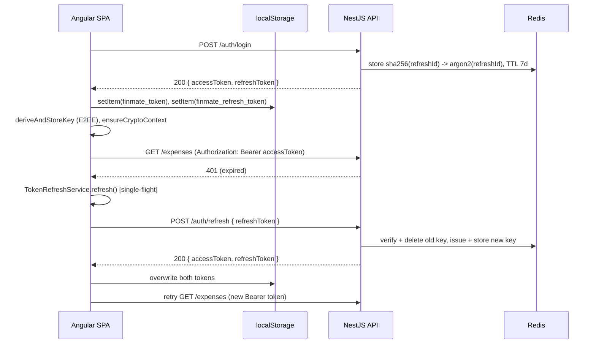
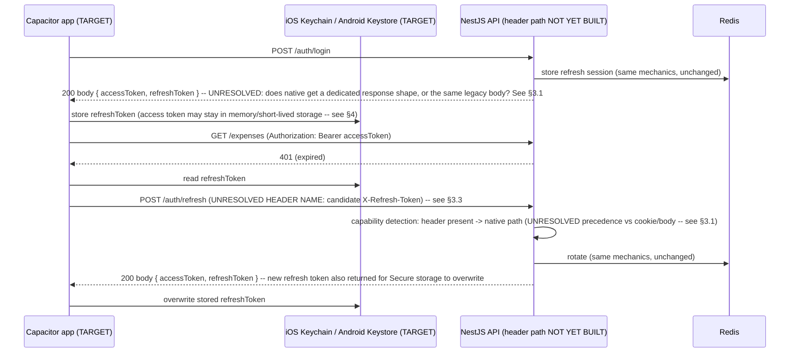

# FinMate - Native Authentication Transport Implementation Specification

**Status:** Specification for a future, explicitly separate implementation
task. **Nature:** Documentation only. This file authorizes no code change,
no feature-flag activation, no dependency installation, no native project
creation, no schema/migration/API change, and no modification to any
accepted ADR or the Decision Ledger. It records engineering design detail
in enough depth that a later, explicitly authorized task can implement it
without re-deriving the architecture — it does not authorize that task to
begin.

**Relationship to prior work:** this document is a companion to
[`FINMATE_MOBILE_CAPACITOR_FUTURE.md`](./FINMATE_MOBILE_CAPACITOR_FUTURE.md)
§15, which already contains the dependency map, readiness matrix, and
sequencing recommendation for `BATCH-06`/`BATCH-14`. **This document does
not repeat that material** — it goes one level deeper, into the exact
flows, contract, and test matrix needed to actually build the native
transport half that §15.1 found has zero code today.

**Unresolved by this document:** which specific header name, precedence
rule, and several other details ADR-013 leaves unspecified. Each is
flagged explicitly in §3/§9 as **[UNRESOLVED — ENGINEERING DECISION]**,
never presented as approved.

---

## 1. Verified Current-State Summary

| Fact | Evidence |
|---|---|
| Both the access token and refresh token are stored in `localStorage` (`finmate_token`, `finmate_refresh_token`) by `AuthState`'s `Login`/`RefreshTokenSuccess` actions and read directly by `jwtInterceptor`/`TokenRefreshService` | `frontend/src/app/core/auth/auth.state.ts` lines 56-58, 99-101, 193-195; `frontend/src/app/core/interceptors/jwt.interceptor.ts` line 16; `frontend/src/app/core/auth/token-refresh.service.ts` line 35 |
| Access token is attached as `Authorization: Bearer <token>` on every outgoing request by `jwtInterceptor`; excluded for `/auth/login`, `/auth/register`, `/auth/refresh` | `jwt.interceptor.ts` lines 14-27 |
| On a 401 (non-auth-endpoint), a single shared refresh request is used across all concurrent callers, then the original request is retried | `jwt.interceptor.ts` lines 29-43; `token-refresh.service.ts` (single-flight `inFlight$`) |
| Refresh tokens are rotated server-side on every use: old Redis key deleted, new one issued, argon2-hashed, 7-day TTL | `backend/src/app/auth/auth.service.ts` `refresh()` lines 466-517 |
| Logout deletes the one active Redis session key for the refresh token used; `revokeAllSessions` deletes all of a user's keys (used by `UsersService.deleteAccount`, verified in prior Account-Ledger work) | `auth.service.ts` lines 526-530, `logout()` line 581+ |
| When `auth.dualTransport` is **ON** (default OFF): login sets `finmate_refresh_token`/`finmate_csrf` HttpOnly cookies in addition to the body; refresh prefers the cookie, validates a CSRF double-submit header, rejects a conflicting body+cookie pair with `AUTH_TOKEN_AMBIGUOUS`, and **omits the refresh token from the response body** on the cookie path; logout clears both cookies | `backend/src/app/auth/auth.controller.ts` lines 141-227; `auth-transport.util.ts` |
| CORS is already configured with `credentials: true` and an env-driven origin allowlist (`CORS_ORIGINS`/`FRONTEND_URL`) — required for any cookie-based cross-origin flow | `backend/src/main.ts` lines 36-41 |
| Login also derives and stores the client-side E2EE master key (`ClientEncryptionService.deriveAndStoreKey`) and initializes the crypto session (`CryptoSessionManager.ensureCryptoContext`); logout tears down the crypto session and clears cached group keys | `auth.state.ts` lines 109-132 (login), 162-167 (logout) — **this coupling must be preserved by any transport change; it is unrelated to which transport carries the token** |
| **No native-header transport code exists anywhere** — confirmed by a repository-wide search for a custom refresh-header read in `auth.controller.ts`/`auth-transport.util.ts` | `FINMATE_MOBILE_CAPACITOR_FUTURE.md` §15.1 |
| Existing test coverage for the cookie/CSRF path is substantial (enumerated in §7) | `auth.controller.spec.ts`, `auth-transport.util.spec.ts`, `token-refresh.service.spec.ts`, `auth-guards.spec.ts` |

---

## 2. Authentication Flow Diagrams

### 2.1 Browser — current legacy path (flag OFF, today's default)



### 2.2 Browser — dual-transport path (flag ON, cookie present)

```mermaid
sequenceDiagram
  participant FE as Angular SPA (TARGET, not yet built)
  participant API as NestJS API (built, flag-gated)
  participant Redis

  FE->>API: POST /auth/login
  API->>Redis: store refresh session (same as 2.1)
  API-->>FE: Set-Cookie finmate_refresh_token (HttpOnly), finmate_csrf (HttpOnly)
  API-->>FE: 200 body { accessToken, refreshToken, csrfToken } (TRANSITION: body still dual-emitted)
  Note over FE: TARGET FE behavior (not yet built): do not persist refreshToken; keep csrfToken for the refresh call

  FE->>API: POST /auth/refresh (Cookie: finmate_refresh_token; X-CSRF-Token: csrfToken)
  API->>API: parseCookies, csrfMatches (constant-time)
  API->>Redis: rotate (same mechanics as 2.1)
  API-->>FE: Set-Cookie finmate_refresh_token (new), finmate_csrf (new)
  API-->>FE: 200 body { accessToken, csrfToken } -- NO refreshToken in body on this path
```

**Note:** the *frontend* half of this path (reading/using the cookie
contract instead of `localStorage`) is **not implemented** — only the
backend emits/accepts it today. This diagram's FE side is target
behavior, explicitly labeled.

### 2.3 Native — target path (ADR-013, zero code exists — this document's main subject)



Every box marked **UNRESOLVED** in §2.3 is a real gap in `ADR-013` as
written — not an oversight of this document. `ADR-013` decides *that*
native uses header+secure-storage; it does not specify the header name,
the exact response shape, or the capability-detection precedence order
when a request carries more than one transport signal.

---

## 3. Native Transport Contract

### 3.1 Capability detection — partially resolved, partially open

**Resolved by `ADR-013` itself:** detection must be by **capability**, not
by platform sniffing (`ADR-013`: "never `if(iOS)`"). The existing cookie
path already establishes the pattern: *presence of a specific signal in
the request* selects the transport, with a defined fallback order.

**[UNRESOLVED — ENGINEERING DECISION]:** the existing fallback order is
`cookie present → cookie path; else → legacy body path`. Adding a native
header introduces a three-way precedence question `ADR-013` does not
answer: if a request somehow carried *both* a cookie and the new header
(should never happen for a correctly-behaving client, but the existing
code already has a precedent for defensively rejecting an analogous
conflict — the `AUTH_TOKEN_AMBIGUOUS` check for cookie vs. body), what
should the server do? **Proposed for review, not approved:** extend the
existing conflict-rejection pattern — reject by **reusing the existing
`AUTH_TOKEN_AMBIGUOUS` code** (corrected 2026-10-30, §12.B/Decision 4 —
no new code is proposed) rather than silently picking one, consistent
with the existing precedent's own stated reasoning ("never let two
different refresh tokens silently succeed").

### 3.2 Login request/response behavior

| Aspect | Resolved? | Detail |
|---|---|---|
| Request shape | Resolved (unchanged) | Existing `LoginDto` (email/password/MFA code) — no native-specific login request field is required by anything in `ADR-013` |
| Response shape for a native caller | **[UNRESOLVED]** | `ADR-013` does not say whether native receives a *different* response (e.g., refresh token always present, no cookie set) or the exact same dual-emit body the web client gets today. **Proposed for review:** native requests should receive the refresh token in the body (as today), since there is no cookie to set for them and the client is responsible for moving it into Keychain/Keystore immediately — the server does not need to know "this is a native client" at login time at all, only at *refresh* time (§3.1), which simplifies this half of the contract. |

### 3.3 Refresh-token transport and rotation

| Aspect | Resolved? | Detail |
|---|---|---|
| Rotation mechanics | **Resolved (unchanged)** | Same Redis rotate-on-use mechanism already in `AuthService.refresh()` — `ADR-013`'s decision text explicitly says "Rotation + Redis session hashing retained." No change proposed here. |
| Header name | **[UNRESOLVED]** | Not specified anywhere in `ADR-013`, the execution plan, or any other inspected document. **Candidate only, not approved:** `X-Refresh-Token`. |
| Header vs. body for the *request* | **[CORRECTED — RESOLVED, see §9 item 3 correction below]** | Previously flagged here as the primary open question. Deeper evidence (`FINMATE_DECISION_LEDGER.md` `AU-1`, **Status: LOCKED**; `FINMATE_SRS.md` `AUTH-004`, **MUST/P0**) shows this is **not open** — the header-based transport is already the locked, frozen architecture, independently of `ADR-013`'s prose. The "keep body, change storage only" option would require formally amending a LOCKED decision, not simply choosing the simpler engineering path. |
| Access-token transport | **Resolved (unchanged)** | `Authorization: Bearer <accessToken>` on every request, identical to web — `ADR-013` does not propose changing this, only refresh-token transport. |

### 3.4 Logout and credential invalidation

Resolved by extension of the existing pattern: logout must delete the
specific Redis session key for the refresh token presented (unchanged
`AuthService.logout`), and — whichever transport decision in §3.3 is
made — the client must clear the token from wherever it stored it
(Keychain/Keystore) exactly as the web client already clears
`localStorage` today (`AuthState.logout`, lines 169-171). No new backend
behavior is required for logout beyond what §3.3 resolves for refresh.

### 3.5 Unauthorized / expired-session handling

Resolved by extension of the existing pattern: `JwtAuthGuard.handleRequest`
already distinguishes `TokenExpiredError` from "missing token" from a
generic invalid-token case (`jwt-auth.guard.ts` lines 13-24) — this is
platform-agnostic and needs no native-specific change.

### 3.6 Concurrent refresh behavior

Resolved by extension of the existing pattern: `TokenRefreshService`'s
single-flight coordination (`frontend/src/app/core/auth/token-refresh.service.ts`)
is a *client-side* mechanism and is reusable as-is for a native client —
the server-side rotation already assumes "first refresh call wins, second
with the same stale token fails," which is exactly why single-flight
coordination exists. No server change needed for this property.

### 3.7 Secure credential storage requirements

See §4 (dedicated section, per the task's own structure).

### 3.8 Error handling and retry behavior

Resolved by extension: the existing `jwtInterceptor`/`TokenRefreshService`
retry-after-refresh pattern is platform-agnostic Angular code and should
work unmodified for a Capacitor-wrapped app, **provided** the token-read
call sites (`localStorage.getItem` in `jwt.interceptor.ts` line 16 and
`token-refresh.service.ts` line 35) are changed to read from whichever
secure-storage abstraction §4 specifies — this is a **required code
change**, not a gap in the existing design, and is explicitly listed as
the first implementation task in §10.

### 3.9 Compatibility with existing browser clients

**Resolved, already proven by existing tests** (§7): the dual-emit design
already guarantees a browser client that has never heard of cookies keeps
working unmodified (flag-OFF path, or flag-ON with no cookie → body
fallback). Adding a native header transport is additive to this and does
not require any change to the browser path.

### 3.10 Required frontend/backend interfaces

| Interface | Change required |
|---|---|
| Backend: `auth.controller.ts` refresh/login/logout handlers | Extend the existing transport branching (§3.1/§3.3) — **exact shape unresolved, see above** |
| Frontend: a secure-storage abstraction service (does not exist) | New — see §4 |
| Frontend: `jwt.interceptor.ts`, `token-refresh.service.ts` | Change their `localStorage.getItem`/`setItem` calls to the new abstraction — **the only required frontend change on the existing files**, everything else (single-flight logic, retry-on-401) is reusable as-is |
| Frontend: `AuthState` (`auth.state.ts`) | Same storage-call substitution in `login`/`logout`/`refreshTokenSuccess`; **the E2EE key-derivation/crypto-session coupling (§1) must be preserved exactly** |

### 3.11 Does the existing dual-transport implementation weaken security by adding native support?

**No, provided §3.1's capability detection rejects ambiguity rather than
guessing** (the same principle the existing cookie-vs-body code already
follows). CSRF double-submit exists specifically because a browser
auto-attaches cookies cross-origin/same-site; a native app's custom header
is **not** ambiently attached by any OS mechanism the way a cookie is, so
it is **not CSRF-vulnerable in the same way** — **[UNRESOLVED —
ENGINEERING DECISION, but low-risk default]:** the native header path
should not need its own CSRF scheme, by the same reasoning the existing
code already applies to why cookies specifically need CSRF and bodies
don't. This is a recommendation for review, not a decision made here.

---

## 4. Secure-Storage Requirements

| Platform | Access token | Refresh token | Mechanism |
|---|---|---|---|
| Browser (web) | Memory/NGXS state today; **[UNRESOLVED whether this changes]** — `ADR-013` only names the *refresh*-token transport as the target change; it does not propose moving the access token out of `localStorage`/memory | HttpOnly cookie (already built, flag-gated) | Unchanged from the existing dual-emit design |
| Native Android | **[UNRESOLVED]** — not named in `ADR-013` beyond "native secure storage"; access tokens are short-lived and commonly kept in memory on native apps, but this document does not assume that without a decision | Android Keystore, via a Capacitor secure-storage plugin — **[UNRESOLVED — ENGINEERING DECISION: which plugin]**, none evaluated in this repository | `ADR-013` names the mechanism (Keystore), not the plugin |
| Native iOS | Same open question as Android | iOS Keychain, via the same (unselected) plugin | `ADR-013` names the mechanism (Keychain), not the plugin |

| Scenario | Required behavior | Resolved? |
|---|---|---|
| App restart (native) | Refresh token must still be readable from Keychain/Keystore without re-login, exactly as a browser reload reads a still-valid cookie/`localStorage` value today | Architecturally implied by `ADR-013`, not yet implemented |
| Logout | Secure storage entry must be deleted, not merely the in-memory reference | Same pattern as existing `localStorage.removeItem` (§3.4) |
| Token rotation | New refresh token overwrites the old one in secure storage on every successful refresh | Same pattern as existing `localStorage.setItem` overwrite (§3.4/2.1) |
| Session expiration (refresh token itself expired/revoked) | Clear secure storage, redirect to login — identical to today's `Logout` action dispatch on a failed refresh (`token-refresh.service.ts` `catchError`) | Reusable as-is once storage calls are substituted |
| Device migration / reinstall | **[UNRESOLVED]** — not addressed by `ADR-013`. A fresh install has no prior Keychain/Keystore entry (iOS Keychain data *can* survive a reinstall depending on configuration; Android Keystore entries are generally tied to the app's signing key and are lost on uninstall) — this is a genuine platform-behavior difference, not invented here, and needs explicit product/engineering input on whether that's acceptable (user simply logs in again) before implementation |
| Failure to access secure storage (e.g. device policy blocks it) | **Must not fall back to `localStorage`, logs, URLs, or any ordinary persistent web storage** — per this task's explicit constraint. **[UNRESOLVED — ENGINEERING DECISION]:** the correct behavior is presumably to fail the login/refresh and surface an explicit error, forcing re-authentication, rather than silently degrading security — this document recommends that default but does not decide it |
| Biometric authentication | **Not required for every login.** Per `ARCHITECTURE.md`'s own "Future Key Vault Architecture (Roadmap)" framing (verified in the prior mobile-proposal session), biometrics are one *optional* local-unlock factor alongside WebAuthn/PIN for the E2EE key vault — a separate concern from whether the refresh token itself is protected. This document does not conflate the two and does not propose making biometrics mandatory. |

---

## 5. Staged Migration and Rollback Plan

| Stage | Scope | Depends on | Rollback |
|---|---|---|---|
| **A — Backend transport readiness (web)** | Verify the already-coded cookie/CSRF path against prod CORS (the execution plan's own stated condition); no new code | None | Flip `auth.dualTransport` back OFF — additive flag, no data migration |
| **B — Browser compatibility verification** | Run the existing test suite (§7) plus a manual regression pass with the flag ON in a non-prod environment | Stage A | Same as A |
| **C — Native transport design decision** | Resolve §3.1/§3.3's open questions (header name/precedence, or the simpler "same body contract, different client-side storage only" option) | Stage B | n/a — design only, no running system affected |
| **D — Native transport implementation** | Backend changes per Stage C's resolved design (if any backend change is even needed — see §3.3's "simpler option") | Stage C | Revert the specific commit; the flag-gated design means this can ship disabled |
| **E — Secure-storage integration** | Native client: select a plugin (§4), substitute storage calls in `jwt.interceptor.ts`/`token-refresh.service.ts`/`auth.state.ts` (§3.10) | Stage D; native project existing (per the mobile proposal's own readiness matrix) | Revert to `localStorage` calls in the native build only — does not affect the web build |
| **F — Automated tests** | New tests for whatever Stage C/D/E actually build (§7 lists what's missing) | Stages C-E | n/a |
| **G — Staging verification** | Full regression (web + native) in a staging environment | Stage F | n/a |
| **H — Production rollout (if separately authorized later)** | Gradual flag enablement, min-version enforcement, compatibility telemetry | Stage G; `W-MOB-04` (min-version) | Extend dual-emit window (per `ADR-015`) |
| **I — Legacy transport retirement** | Remove body-token emission **only** when all five `ADR-015` conditions hold (§6) | Stage H + §6 fully satisfied | Re-enable body emission (explicitly named in `ADR-015`'s own rollback field) |

**This task does not execute any stage above.** Stages A-C could begin as
verification/design work without touching production; D onward require a
separate, explicitly authorized implementation task.

---

## 6. The Five-Condition Sunset Checklist (verbatim from `ADR-015`, not paraphrased)

`ADR-015` line 4: *"the old refresh-token body path is retained (dual-emit)
until **all** hold: web cookie refresh works, native secure-storage header
refresh works, minimum-supported mobile version is enforced, compatibility
telemetry confirms the old path is unused, and the sunset condition is
met."*

| # | Condition (exact) | Current status |
|---|---|---|
| 1 | Web cookie refresh works | **Built, flag-gated, not yet verified in prod** (§1, §5 Stage A) |
| 2 | Native secure-storage header refresh works | **Not built at all** (§1, §3) |
| 3 | Minimum-supported mobile version is enforced | Not built — no min-version enforcement mechanism was found anywhere in this repository |
| 4 | Compatibility telemetry confirms the old path is unused | Not built — no telemetry for old-path usage was found |
| 5 | The sunset condition is met | **The sunset calendar date is itself an `[ENGINEERING PARAMETER]`, explicitly not yet set** (`ADR-015` line 4, `OQ-17`) |

**Body-token removal (`SEC-003`) is satisfied only at sunset, i.e. only
when all five above are simultaneously true.** `ADR-015`'s own rollback
field: *"Extend dual-emit window / re-enable body emission."*

---

## 7. Test and Acceptance Matrices

### 7.1 Authentication correctness

| Case | Existing test | Status |
|---|---|---|
| Valid login (legacy) | `auth.controller.spec.ts` "login returns body tokens and sets NO cookies" | **Covered** |
| Valid login (cookie) | `auth.controller.spec.ts` "login sets a host-only HttpOnly refresh cookie + CSRF cookie and dual-emits" | **Covered** |
| Invalid credentials | Not located in the inspected files this session | **Gap — verify in `auth.service.spec.ts` before assuming untested** |
| Expired access token | `jwt-auth.guard.ts` branch exists; guard-level unit coverage not confirmed this session | **Partially verified — code path exists, test presence not confirmed** |
| Expired/invalid/revoked refresh token | `auth.service.spec.ts` likely covers this (not re-read line-by-line this session) | **Not independently confirmed — flagged, not claimed** |
| Successful refresh + rotation (legacy body) | `auth.controller.spec.ts` "refresh with a body token returns both tokens in the body" | **Covered** |
| Successful refresh + rotation (cookie) | `auth.controller.spec.ts` "refresh via cookie with a valid CSRF token rotates and returns NO refresh token in the body" | **Covered** |
| Logout + subsequent rejection | `auth.controller.spec.ts` "logout uses the body token and clears no cookies" / "logout reads the cookie token and clears both transport cookies" | **Covered for the logout call itself; subsequent-request-rejection is implied by Redis key deletion, not separately asserted in these tests** |
| **Native login/refresh/logout (any transport)** | **None exist — no native-header code exists to test** | **Missing — new tests required once §3 is resolved** |

### 7.2 Transport security

| Case | Existing test | Status |
|---|---|---|
| Cookie transport, valid CSRF | Covered (above) | **Covered** |
| Missing CSRF header | `auth.controller.spec.ts` "refresh via cookie with a MISSING CSRF header is forbidden" | **Covered** |
| Invalid CSRF header | `auth.controller.spec.ts` "refresh via cookie with an INVALID CSRF header is forbidden" | **Covered** |
| Ambiguous cookie+body conflict | `auth.controller.spec.ts` "refresh rejects conflicting cookie + body tokens (no silent success)" | **Covered** |
| Cookie attribute correctness (HttpOnly/Secure/SameSite/host-only/path-scoped) | `auth-transport.util.spec.ts` "refresh cookie is HttpOnly, Secure, SameSite=Lax, host-only, path-scoped" / same for CSRF cookie | **Covered** |
| CSRF constant-time comparison | `auth-transport.util.spec.ts` "csrfMatches (constant-time double-submit)" | **Covered** |
| CORS behavior for supported origins | `main.ts`'s `enableCors({ credentials: true })` exists; no automated test for the origin allowlist was located this session | **Gap** |
| **Native header transport, any scenario** | **None — no code exists** | **Missing** |
| No tokens in URLs/logs | Not independently verified this session; the Account-Ledger work's `redactSensitiveKeys` finding (verified: no `token`/`refreshtoken`/`accesstoken` key-name coverage gap — those ARE on the redaction list, unlike financial-amount fields) is relevant precedent that tokens specifically are already redaction-covered by key name | **Partially verified via a related finding, not re-confirmed directly this session** |

### 7.3 Reliability

| Case | Existing test | Status |
|---|---|---|
| Concurrent refresh requests | `token-refresh.service.spec.ts` "shares a single refresh request across concurrent callers (no logout storm)" | **Covered (client-side)** |
| Fresh refresh after a prior one completes | `token-refresh.service.spec.ts` "starts a fresh refresh after the previous one completes" | **Covered** |
| Server rejects refresh → logout | `token-refresh.service.spec.ts` "logs out (once) and errors when the server rejects the refresh token" | **Covered** |
| No valid refresh token → immediate logout | `token-refresh.service.spec.ts` "logs out immediately when there is no valid refresh token" | **Covered** |
| Network failure during refresh | Not located this session | **Gap** |
| App restart (native) | N/A — no native build exists | **Missing — new scenario entirely** |
| Secure-storage failure | N/A — no secure storage exists yet | **Missing — new scenario, see §4** |
| Interrupted login/logout | Not located this session | **Gap** |
| Duplicate refresh attempts (server-side: second use of an already-rotated token) | Implied by the Redis delete-on-use mechanism (`auth.service.ts`); a direct test asserting the *second* call with the stale token fails was not independently located this session | **Likely covered by design, not independently confirmed** |
| Recovery from an expired session | `auth-guards.spec.ts` "allows access when access is expired but refresh is valid" (route-guard level) | **Covered at the guard level** |

### 7.4 Compatibility

| Case | Existing test | Status |
|---|---|---|
| Existing browser login/session flows, flag OFF | `auth.controller.spec.ts`'s entire "flag OFF" describe block | **Covered** |
| Existing API clients/automated tests unaffected | Implied by the flag defaulting OFF and the "flag OFF" test block asserting byte-for-byte legacy behavior | **Covered** |
| Native-client authentication contract | **Cannot be tested — contract itself is unresolved (§3)** | **Blocked on §3's design decisions, not a testing gap per se** |
| Feature-flag OFF behavior | Covered (above) | **Covered** |
| Feature-flag ON behavior in a controlled test environment | Covered by the existing "flag ON" describe block; **not yet verified against a real prod-like CORS configuration** (the execution plan's own open condition) | **Partially covered — unit-level yes, environment-level no** |

**No test in any of the four matrices above was executed as part of this
task.** Status columns reflect static inspection of test file contents
(`describe`/`it` names), not an actual test run.

---

## 8. BATCH-06 → BATCH-14 Dependency Table

| Item | Current verified status | Prerequisites | Blocking dependencies | Acceptance criteria | Evidence | Next action |
|---|---|---|---|---|---|---|
| `BATCH-06` backend transport readiness (web cookie) | **Code-complete, tested, flag OFF** | None | Flag flip + prod CORS verification (execution plan's own stated condition) | `auth.dualTransport=ON` passes §7.1-7.4's "flag ON" rows in a prod-like environment | §1, §7 | Flip flag in a non-prod env; run existing suite; verify CORS |
| Native-header transport | **Not started — zero code** | §3's design decisions resolved | Nothing blocks *starting* the design work; implementation blocks on the design being resolved | Server accepts the resolved transport (header or body+storage-only, per §3.3) for a native-identified request | §3, §8 | Resolve §3.1/§3.3's open questions first — this is the actual next task, see §10 |
| Secure credential storage (client-side) | **Not started — no plugin selected, no native project exists** | Native project creation (mobile proposal §15.6); plugin selection (§4) | Both unstarted | Refresh token readable/writable via Keychain/Keystore, not `localStorage`, on a running native build | §4 | Select a Capacitor secure-storage plugin for review before any installation |
| `BATCH-14`/`W-MOB-01` secure storage | **Blocked (native)**, per execution plan | Native-header transport + secure credential storage, both above | Both unstarted | Tokens never touch `localStorage`/WebView JS-accessible storage on native | Mobile proposal §15 | Do not schedule until the two rows above are resolved |
| `W-MOB-02` push notifications | **Blocked**, per `ADR-021` (OS push is TARGET, gated on native push infra) | A native project + a push plugin + vendor (FCM/APNs) registration, none started | `VEN-1` vendor review not started | Content-free push payloads only, per `ADR-021` | Mobile proposal §5 feature #5 | Not this document's scope — unchanged from the mobile proposal |
| `W-MOB-03` deep links | **Not started** | Native project + hosted verification files (`assetlinks.json`/`apple-app-site-association`) | Neither started | Opening a shared link on a device with the app installed opens directly to the target screen | Mobile proposal §5 feature #13 | Not this document's scope |
| `W-MOB-04` minimum supported version | **Not started — no mechanism found anywhere** | None technical | Design decision on enforcement mechanism (header check? app-store-forced-update?) | Old clients below the minimum version are rejected or prompted to update | `ADR-015` condition 3 (§6) | Design needed — not scoped in this document |
| Capacitor project creation (Android) | **Not started** | None technical | Governance-owner approval (per repo convention — never install without telling the user first) | `npx cap add android` succeeds | Mobile proposal §15.6 | Await explicit approval |
| Capacitor project creation (iOS) | **Not started** | macOS/Xcode environment — **not available in this session** | Environment + approval | `npx cap add ios` succeeds on a macOS machine | Mobile proposal §15.6 | Identify macOS/Xcode access before scheduling |
| Android build validation | **Not started** | Project creation above | Same | App builds and launches on an emulator/device | Mobile proposal §15.6 | Blocked on project creation |
| iOS build validation | **Not started** | Project creation above + macOS/Xcode | Same | App builds and launches on a simulator/device | Mobile proposal §15.6 | Blocked on project creation + environment |

**No batch above is marked complete because partial code exists.**
`BATCH-06` is split into its web half (code-complete) and native half (not
started) precisely so this distinction is never collapsed into a single
"BATCH-06 done" claim.

---

## 9. Unresolved Design Decisions (consolidated from §3-§6)

1. **Capability-detection precedence** when more than one transport signal could theoretically be present (§3.1).
2. **Exact native refresh-token header name**, if a header is even the chosen mechanism (§3.3) — candidate `X-Refresh-Token` only, not approved.
3. ~~Whether the backend contract needs to change for native at all~~ — **CORRECTED (2026-10-30), no longer open.** `FINMATE_DECISION_LEDGER.md` **`AU-1` — Dual-transport refresh** is **Status: LOCKED** and its decision text explicitly states: *"Native = refresh token in iOS Keychain / Android Keystore via Capacitor secure storage, **sent by header**."* `FINMATE_SRS.md` **`AUTH-004`** independently states the same requirement at **MUST/P0**: *"Native refresh via Keychain/Keystore **header**; backend capability-detects transport; header path never satisfiable by ambient cookie."* Keeping the existing body contract for native (no header) is therefore **not a neutral, equally-available engineering choice** — it would require formally amending a **LOCKED** Decision Ledger item and a **MUST/P0** SRS requirement, per this repository's own change-control rule ("do not silently change a LOCKED decision"). The adversarial SRS review (`FINMATE_SRS_ADVERSARIAL_REVIEW.md`, finding **F-02**) already anticipated and rejected exactly this failure mode: if native keeps using the body path, `SEC-003` ("remove refresh token from body," MUST/P0, currently **OPEN**) **can never close**, because native would remain a permanent legitimate consumer of the path being removed. **What remains genuinely unresolved is narrower:** the exact header name, the three-way (cookie/header/body) precedence rule, and the secure-storage plugin — all still correctly flagged below, none of them the top-level "which approach" question.
4. **Whether a native-specific login response shape is needed** (§3.2).
5. **Whether the native header path needs its own CSRF-equivalent scheme** (§3.11) — recommended default: no, but not decided.
6. **Which Capacitor secure-storage plugin to use** (§4) — none evaluated.
7. **Whether the access token's storage location changes on native** (§4) — `ADR-013` is silent on this; it only names the refresh token's transport as the target change.
8. **Device migration/reinstall behavior** (§4) — genuine platform-behavior difference, not a FinMate choice alone, needs explicit product sign-off.
9. **Secure-storage failure behavior** (§4) — recommended default: fail closed and force re-authentication, not decided.
10. **Minimum-version enforcement mechanism** (§8, `W-MOB-04`) — not designed at all yet.
11. **Compatibility-telemetry design** (`ADR-015` condition 4) — not designed at all yet.
12. **The sunset calendar date itself** — explicitly an open `[ENGINEERING PARAMETER]` per `ADR-015`/`OQ-17`.

---

## 10. Exact Next Implementation Task and Its Prerequisites

**Corrected (2026-10-30):** the next task is **not** "decide whether native
needs a header" — `AU-1` (Decision Ledger, LOCKED) and `AUTH-004` (SRS,
MUST/P0) already decide that. The next task is narrower still:

> **Resolve the implementation-level details of the already-locked header
> transport**: the exact header name, the three-way (cookie/header/body)
> capability-detection precedence rule (including an explicit rejection
> behavior for an ambiguous multi-transport request, mirroring the
> existing `AUTH_TOKEN_AMBIGUOUS` cookie-vs-body check), and the
> secure-storage plugin. None of these are specified by `AU-1`/`AUTH-004`
> beyond "by header" and "never satisfiable by ambient cookie."

**Why this is the correct next task:** `AU-1`/`AUTH-004` remove the
top-level architecture question entirely; what remains is the same kind of
narrow, implementation-level decision set already listed in §9 (items 2,
4-6). No backend-vs-frontend-only fork remains open to resolve first.

**If a backend-change-avoiding approach is still wanted:** that is now a
request to **amend `AU-1`/`AUTH-004`**, not a default-available
engineering option. Per this repository's own change-control rule, that
requires a new dated Decision Ledger entry plus an ADR — a governance
action with an identifiable cost (`SEC-003` could then never close per
`F-02`'s already-documented failure mode), not a lighter default path.

**Prerequisites:**
- No native project needs to exist to resolve the header name/precedence/plugin questions — these are design decisions, not implementation.
- Does not require governance-owner approval to *discuss* the implementation details of the already-locked design; would require it before implementing any of them, and would require a separate, explicit governance action if `AU-1`/`AUTH-004` amendment is pursued instead.

**Prerequisites for the implementation task that follows that decision:**
- The decision above, recorded.
- A selected secure-storage Capacitor plugin (§4, #6).
- An approved native project (§8) — or, if the decision in §10 resolves to "frontend-only," the storage-substitution code could in principle be written and tested with a plugin stub before a full native project exists, though it cannot be verified end-to-end without one.

---

## 11. Final Reconciliation

- **CURRENT:** the web-cookie half of `BATCH-06` is fully built and tested behind a flag; the native-header half has no code; no secure-storage mechanism, plugin, or native project exists; the E2EE login/logout coupling in `AuthState` is real and must be preserved by any transport change.
- **TARGET (per `AU-1`/`AUTH-004`/`ADR-013`/`ADR-015`, not modified by this document):** native uses Keychain/Keystore via a **header-based** transport — locked, not an open choice per the 2026-10-30 correction above — capability-detected, with the existing rotation/revocation mechanics unchanged, under a five-condition dual-emit sunset.
- **Not changed by this document:** any application code, feature flag, dependency, native project, schema, migration, API, accepted ADR, or the Decision Ledger. The Account/Balance Ledger gates (`ACC-2a`, `ACC-4`, `ACC-5`, `ACC-6`, `ACC-2b`) are untouched and unaffected.

**One-line status:** Implementation-ready specification with explicitly
flagged open design decisions; no implementation authorized by this
document.

---

## 12. Proposed Native Refresh-Token Header Contract (added 2026-10-30)

**PROPOSED — NOT APPROVED.** `AU-1`/`AUTH-004` already lock in that native
uses a header; this section proposes the specific header, precedence
rules, and behavior. Nothing here is implemented or authorized.

### 12.A — Header name

**No existing repository or standard specifies one.** Searched `AU-1`,
`AUTH-004`, `ADR-013`, `ADR-015`, `ADR-021`, `auth-transport.util.ts`,
`auth.controller.ts` — none name a header.

**Candidate — PROPOSED, NOT APPROVED: `X-Refresh-Token`.**

Rationale, checked against actual repository conventions:
- Matches the existing custom-header naming pattern exactly: `x-mfa-code` (`auth.controller.ts:120`, `mfa.guard.ts:18`), `x-csrf-token` (`auth-transport.util.ts:22`), `x-correlation-id`/`x-request-id` (`http-exception.filter.ts:216-217`) — all lowercase, hyphenated, `x-`-prefixed.
- **No collision found** with any existing header name in the codebase.
- **CORS:** `main.ts`'s `app.enableCors({ origin: corsOrigins, credentials: true })` (verified, no `allowedHeaders` set) relies on the `cors` package's default behavior of reflecting whatever headers a preflight requests — a new custom header requires **no CORS config change**, unlike a locked-down `allowedHeaders` allowlist (which this codebase does not use).
- **Proxy behavior:** not verified — whether a production reverse proxy/CDN passes arbitrary custom headers through is infrastructure-specific and outside this repository's code; flagged as an operational prerequisite (same category as `TRUST_PROXY`/`CORS_ORIGINS`, already documented as "deployment-specific and MUST be set by operations" in `security-config.util.ts`).
- **Logging:** verified directly — `backend/src/app/interceptors/logging.interceptor.ts` (`logRequest`, lines ~30-60) **never logs raw request headers**; it logs only `timestamp, method, url (redacted via redactUrl), userId, ip (hashed), status, responseTime, throttleKey, limit, remaining`. A new header is **not** exposed by the existing request-logging path. (Caveat: this covers only this one interceptor — see §12.D security analysis.)
- **Security middleware:** Helmet's CSP (`buildCspDirectives`) governs response content, not request headers — no interaction.

**If this candidate is rejected, the only requirement from `AU-1`/`AUTH-004` that any replacement must satisfy is:** delivered via a header, and "never satisfiable by ambient cookie" (i.e., not something a browser auto-attaches).

### 12.B — Transport Precedence and Ambiguity Handling

**Correction/refinement (2026-10-30, second pass):** re-reading the
feature-flag registry directly (`backend/src/app/platform/feature-flags.constants.ts`
lines 23, 85-89) shows a **second, already-registered flag exists for
exactly this purpose**: `mobile.secureStorage` (`FEATURE_MOBILE_SECURE_STORAGE`,
default OFF, description *"BATCH-14 native secure-storage refresh
transport"*) — distinct from `auth.dualTransport` (BATCH-06, gates the web
cookie half only). **Proposed:** the header branch should be gated behind
`mobile.secureStorage`, independently of `auth.dualTransport`, since the
two batches ship on independent timelines. This means the two flags can
each be ON/OFF independently — four combinations, not the single-flag
model implied earlier in this document:

| `auth.dualTransport` | `mobile.secureStorage` | Behavior |
|---|---|---|
| OFF | OFF | Legacy body only — **today's exact, unchanged behavior** |
| ON | OFF | Cookie-or-body — **today's exact BATCH-06 behavior, unchanged** |
| OFF | ON | **[PROPOSED]** Header-or-body — native header support ships independently of web cookie support |
| ON | ON | **[PROPOSED]** Full three-way: header, cookie, or body |

Proposed per-combination decision table, extending the **existing, verified** cookie-vs-body logic (`auth.controller.ts` lines 157-203) with a third branch:

| Transports present | Proposed outcome | Basis |
|---|---|---|
| Cookie only (flag ON) | Cookie path (unchanged) | **Existing, verified** |
| Body only (flag OFF, or ON with no cookie/header) | Body path (unchanged) | **Existing, verified** |
| Header only | **[PROPOSED]** New header path: validate against `AuthService.refresh()` exactly as the other two paths already do | New, mirrors existing pattern — no change to `AuthService` itself |
| Cookie + body, equal values | Cookie path wins silently (unchanged) | **Existing, verified** (`auth.controller.ts:173`: only errors on *mismatch*) |
| Cookie + body, different values | `400 AUTH_TOKEN_AMBIGUOUS` (unchanged) | **Existing, verified** |
| Header + cookie (any values) | **[PROPOSED, but flagged UNRESOLVED below]** reject outright with the existing `AUTH_TOKEN_AMBIGUOUS` code, regardless of whether values match | A legitimate single request should never carry both — unlike cookie+body (where a transitioning web client might technically still send both), a native client has no reason to ever present a cookie |
| Header + body, equal values | **[PROPOSED]** allow, prefer header, mirroring the cookie+body precedent | Consistency with existing precedent |
| Header + body, different values | **[PROPOSED]** `400 AUTH_TOKEN_AMBIGUOUS` — **reuse the existing code** (corrected below), not a new one | Mirrors `AUTH_TOKEN_AMBIGUOUS`'s own stated reasoning: "never let two different refresh tokens silently succeed" |
| All three present | **[PROPOSED]** reject with `AUTH_TOKEN_AMBIGUOUS` | Same reasoning |
| Missing/malformed (empty, wrong type) on every transport | `400 VAL_INVALID_INPUT` (unchanged) | **Existing, verified** (`auth.controller.ts:196-200`) |
| Invalid/expired/revoked token (any transport) | `401 Unauthorized` (unchanged) | **Existing, verified** — `AuthService.refresh()` throws identically regardless of how the token arrived (`auth.service.spec.ts` lines 713, 721 already test this for the body path; the method itself does not branch on transport) |
| Replayed (already-rotated) token | `401 Unauthorized` (unchanged) | **Existing, verified** — Redis key deleted on rotation (`auth.service.ts` ~line 484-490: `if (!storedHash) throw UnauthorizedException`) |

**[UNRESOLVED — PRODUCT/SECURITY DECISION]:** whether "header + cookie, equal values" should be treated the same as the lenient cookie+body precedent (allow) or rejected outright (strict — proposed above, since a native client has no legitimate reason to ever present a cookie). This document proposes the strict reading but does not decide it.

**None of this weakens the existing cookie/CSRF/rotation/ambiguity protections** — every existing branch in the table above is reproduced unchanged; only new branches are added.

### 12.C — Native Capability Detection

**No new "detection" primitive is proposed or needed.** The existing code already dispatches on transport *presence*, not on any claim about client type — `if (cookie present) → cookie path; else → body path` (verified, `auth.controller.ts:159-194`). Adding a header branch is the same pattern: `if (header present) → header path`, with no new concept introduced.

**Explicit, load-bearing security point:** the header's presence proves **nothing** about whether the caller is a genuine Capacitor native app. Any HTTP client — a script, a malicious page issuing a cross-origin request, `curl` — can set an arbitrary header. **This is not a weakness introduced by this proposal; it is the same security model the codebase already has for the body and cookie paths**: the actual security boundary is, and remains, possession of a valid, unexpired, Redis-tracked, rotate-on-use refresh token (unchanged by this proposal). "Capability detection" in `AU-1`/`AUTH-004`'s wording means *transport-format selection*, not *client authentication* — no mechanism in this proposal, or anywhere in the existing code, authenticates "this is a native app" as a security property, and none should be assumed to.

If true app-attestation (cryptographic proof of a genuine, unmodified native binary) is ever desired, that is a materially different, much larger feature (e.g. platform attestation APIs) — **out of scope for this proposal** and not implied by anything here.

### 12.D — Compatibility and Migration

- **Existing browser clients:** unaffected — every existing branch (flag OFF, flag ON cookie, flag ON body-fallback) is preserved verbatim (§12.B).
- **Native migration path:** once built, native clients would send the header on `/auth/refresh` instead of (eventually) the body; `/auth/login`'s response already includes the refresh token in the body today regardless of flag state (verified, `auth.controller.ts` lines ~141-147: the dual-emit response always includes the full body payload "for legacy clients") — a native client reads it from there and stores it via secure storage, then switches to the header for subsequent refreshes. No login-response contract change is proposed.
- **Legacy body transport:** remains supported throughout, per `ADR-015`'s dual-emit requirement — this proposal adds a branch, it does not remove any existing one.
- **Telemetry:** not designed here (§9 item 5 remains open) — but structurally, a telemetry event fired once per request noting *which* branch of the §12.B table was taken would let the existing-but-unbuilt `AUTH-005` condition 4 ("compatibility telemetry confirms the old path is unused") eventually become checkable — specified only at the concept level, not designed in detail.
- **Minimum-version enforcement:** not designed here (§9 item 4 remains open) — unrelated to the header contract itself; this proposal does not depend on it existing first.
- **`AUTH-005`'s five conditions:** this proposal, if approved and implemented, would make condition 2 ("native secure-storage header refresh works") achievable for the first time — it does not by itself satisfy conditions 1, 3, 4, or 5.

**No sunset date is proposed or implied.** No condition is claimed satisfied by this document.

### Security Analysis (§4 of this task)

| Concern | Assessment |
|---|---|
| Credential ambiguity / downgrade risk | Addressed by §12.B's ambiguity table — every multi-transport combination either resolves deterministically to the existing lenient-match precedent or rejects explicitly; no combination is silently decided in favor of a *weaker* transport |
| Cookie/CSRF behavior | **Unchanged** — CSRF double-submit remains mandatory for the cookie path exactly as today; the header path is proposed to need no CSRF-equivalent, because CSRF specifically defends against a browser's *ambient* (automatic) credential attachment, which a header never has — a request forger would need to already possess the secret value to set the header, at which point CSRF-style protection adds nothing. **This reasoning is proposed, not verified against a security review.** |
| Refresh-token rotation / replay protection | **Unchanged** — `AuthService.refresh()`'s Redis rotate-on-use mechanism (verified, lines 466-517) is transport-agnostic already; the header path reuses it exactly, with no new replay surface |
| Token leakage via logging/proxies/error reports/telemetry | **Verified**: the existing request-logging interceptor never logs raw headers (§12.A). **Not verified**: whether any *other* logging call site (error reporting, future debug code, an upstream reverse proxy's own access log) might capture headers — flagged as a gap, not a current exposure. **Recommendation, not implemented:** if headers are ever logged by future code, no existing redaction utility (`redactUrl`, `redactSensitiveKeys`) currently covers header *names*; a `redactHeaders`-style helper would need to be added at that time, mirroring the existing `SENSITIVE_META_KEYS` pattern. |
| Header forwarding / CORS | Default CORS config already reflects arbitrary requested headers (verified, §12.A). **Native HTTP client — re-verified 2026-10-30:** `capacitor.config.ts` has no `server`/native-bridge configuration block, `package.json` has no `@capacitor/http` or equivalent plugin, and no `CapacitorHttp` symbol is used anywhere in `frontend/src`. `AuthService` (`auth.service.ts`) uses plain Angular `HttpClient` — meaning, absent a future plugin decision, requests run through the WebView's own networking, not a native bridge. **This does not block the header decision:** unlike cookies (which `ADR-013`'s own "Problem" statement says "don't behave reliably inside a Capacitor WebView" — the reason native uses a header at all), an explicit request header set via `HttpClient.post(url, body, {headers})` is constructed by application code, not ambiently attached by the WebView — it behaves identically whether or not `CapacitorHttp` native bridging is ever enabled. **Conclusion: the native-HTTP-client selection is orthogonal to this proposal, not a prerequisite for it.** |
| Conflicting/malformed credentials | Covered explicitly in §12.B's table; no combination is silently resolved |
| Does the header alone prove "native"? | **No — explicitly addressed in §12.C.** Placing a token in a header does not make it secure by itself; security comes entirely from the token's own properties (rotation, Redis tracking, expiry), unchanged from today |

### Test and Acceptance Matrix (§5 of this task)

| Case | Supported by this proposal? | Note |
|---|---|---|
| Existing browser refresh (flag OFF, flag ON cookie, flag ON body-fallback) unchanged | Yes — no existing branch is modified | Re-verify via existing `auth.controller.spec.ts` suite, unchanged |
| Valid native header refresh | Depends on §12.A (header name) being settled | New test, not yet written |
| Missing/malformed header | Depends on §12.A | New test — proposed outcome: falls through to cookie/body check, then `VAL_INVALID_INPUT` if none present, mirroring existing empty-body handling |
| Header + cookie conflict | Depends on §12.B's unresolved strict-vs-lenient decision | **Blocked on an unresolved decision — do not write this test until §12.B's open question is resolved** |
| Header + body, matching/conflicting | Depends on §12.A/B | New test |
| Ambiguous-credential rejection (reused `AUTH_TOKEN_AMBIGUOUS` code) | Depends on §12.A/B | New test *scenario*, existing error code — no new code to approve |
| Expired/revoked/replayed token via header | Mechanically covered once §12.A exists — `AuthService.refresh()` already throws identically regardless of transport (verified) | New *test*, but **zero new service logic** — same assertions as the existing body-path tests (`auth.service.spec.ts:713,721`), just invoked via the new transport |
| Refresh-token rotation via header | Same — `AuthService.refresh()` unchanged | New test, zero new logic |
| Legacy body-path compatibility during migration | Already covered by existing tests; unaffected by this proposal | No new test needed |
| Logging/telemetry redaction | Partially supported — the "headers aren't logged today" finding (§12.A) is itself testable right now if desired, independent of whether the header contract is approved | Could be written today as a regression-guard test, but is **outside this proposal's scope** to add unprompted |

### Remaining Decisions (§6 of this task)

1. **Header name** — candidate `X-Refresh-Token` proposed; not approved. **Owner: unassigned.**
2. **Header+cookie precedence (strict reject vs. lenient-if-equal) and the two-flag gating structure** (`auth.dualTransport` × `mobile.secureStorage`, §12.B) — proposed, not decided. **Owner: unassigned.**
3. **Whether CSRF-equivalent protection is needed for the header path** — proposed "no," not decided. **Owner: unassigned** (security review recommended).
4. **Error code for credential ambiguity** — **corrected 2026-10-30:** recommend **reusing the existing `AUTH_TOKEN_AMBIGUOUS`** code (verified: no existing code already covers this exact case the way a dedicated new one would, but `AUTH_TOKEN_AMBIGUOUS`'s current message generalizes trivially; no `*AMBIGUOUS*`/`*TRANSPORT*`/`*CONFLICT*`-named code already handles the header case specifically). This is a recommendation, not approved. **Owner: unassigned.**
5. **Native HTTP client mechanism** — **resolved as non-blocking, 2026-10-30:** confirmed unselected (no `@capacitor/http`-equivalent plugin, no `CapacitorHttp` usage, no `server` config in `capacitor.config.ts`), but shown to be orthogonal to the header contract (§12.D security table) — headers behave consistently with or without a future native-bridge plugin, unlike cookies. **No decision blocks on this item**; it remains open only for whichever *other* native capabilities (if any) genuinely need it.

### Exact Changes If Approved (§8 item 8 of this task)

Listed for a **future, separately authorized** implementation task — not made here:
- `auth-transport.util.ts`: add a `REFRESH_HEADER` constant (name per decision #1) and a header-read helper, mirroring `parseCookies`'s shape.
- `auth.controller.ts` `refresh()`/`logout()`: add the header branch per §12.B's table, gated behind `mobile.secureStorage` (already registered, no new flag), reusing the existing `AUTH_TOKEN_AMBIGUOUS` code for ambiguity rejection (no new error code to register).
- New tests per the matrix above.
- No change to `AuthService`, `RefreshTokenDto`, `main.ts`'s CORS config, the feature-flag registry, or any existing passing test.

---

## 13. Web Cookie Migration — Decision Record and Implementation (2026-10-30)

**Status: APPROVED (Decision Ledger `AU-5`/`AU-6`/`AU-7`) and IMPLEMENTED in this change.** This section records what the Product Owner approved, what was built to realize it, and which decisions remain explicitly open (Decision 4, below) — it does not retroactively approve anything beyond what `AU-5`/`AU-6`/`AU-7` state.

### 13.1 What was approved

1. **`AU-5` — Shared identity, platform-isolated sessions.** Web/iOS/Android share one account and backend identity service; each platform gets its own transport and storage; sessions are independently revocable; no shared/hybrid session is required for V1.
2. **`AU-6` — Web cookie authentication replaces `localStorage`.** `auth.dualTransport` becomes the effective default for web; the frontend stops persisting any token to `localStorage`; the API response contract (refresh token still present in the login/refresh body) is **not** changed, so non-browser/future-native consumers are unaffected — only the web client's use of that field changes.
3. **`AU-7` — Native stays a separate, later phase.** This migration does not implement, select a package for, or set any lifetime for native auth.

### 13.2 What was implemented

- **Backend:** `FEATURE_AUTH_DUAL_TRANSPORT` default flipped from `false` to `true` in `backend/src/app/platform/feature-flags.constants.ts` — this is the only backend behavior change. The cookie/CSRF/rotation/ambiguity-rejection code itself was already built and tested (`auth.controller.ts`, `auth-transport.util.ts`) and is unchanged by this migration. The response body still includes the refresh token on login (dual-emit, per `AU-4`/`AUTH-005`) — **this was deliberately not removed**, per the task's explicit instruction not to assume every response must stop containing token fields.
- **Frontend:** `AuthState` no longer reads or writes `finmate_token`/`finmate_refresh_token` in `localStorage`. The access token and CSRF token live in NGXS state (in-memory only, cleared on page reload by design — this is the intended security property of "access token in memory only" per `AU-1`). `jwt.interceptor.ts` reads the access token from the store instead of `localStorage`, and attaches `withCredentials: true` so the browser sends the refresh/CSRF cookies. `token-refresh.service.ts` no longer reads a refresh token from `localStorage` — the cookie-based refresh call sends no body token and includes the `X-CSRF-Token` header from in-memory state, with `withCredentials: true`.
- **Bootstrap/reload behavior:** because the access token no longer survives a page reload (it was never written to `localStorage`), app startup now attempts one silent cookie-based refresh before deciding the user is logged out. This is new behavior required by the migration, not present before.
- **Existing-session migration:** users who were mid-session under the old `localStorage` model are **not** silently converted. On first load after this change, no in-memory access token exists and no refresh cookie exists either (it was never set under the old flag-OFF behavior), so the silent-refresh bootstrap fails and the user is routed to login — an explicit, intentional re-authentication, not a silent token transplant. No server-side session invalidation was required or performed for this migration (old Redis refresh sessions, if any were still valid, simply become unreachable from the web client since it no longer holds the old body-stored refresh token in `localStorage`; they will expire naturally within 7 days or can be revoked via `revokeAllSessions` if desired — not performed here since no evidence of session hijacking motivates it).
- **Rollback:** flip `FEATURE_AUTH_DUAL_TRANSPORT` back to `false` and revert the frontend commit — both are independent, additive changes with no data migration involved.

### 13.3 Decision 4 — Remaining open items (none resolved by this migration)

Each item below follows the required structure: what's unknown · current code behavior · affected clients/workflows · security/compatibility implications · options and recommendation · approval needed.

1. **Web cookie/header/body credential precedence beyond cookie+body** (header rows do not yet exist — see §12.B). *Current:* cookie+body already resolved (existing, tested); header rows have no code. *Affects:* future native clients only. *Implications:* none for web today. *Options:* per §12.B's table, strict-vs-lenient header+cookie unresolved. *Approval:* Product + Security, once native work begins — not blocking this web migration.
2. **Multiple conflicting credential types beyond cookie+body.** Same status as item 1 — mechanically unreachable until header code exists.
3. **Whether the refresh-token field stays in response bodies for every client, forever.** *Current:* yes, dual-emitted, per `AU-4`/`AUTH-005` — this migration does not change the contract. *Affects:* any non-browser API consumer, and future native clients. *Implications:* this is exactly `SEC-003`'s open question — removal happens only at the 5-condition sunset (`AUTH-005`), none of which are satisfied yet. *Approval:* Product Owner, per `OQ-17`.
4. **Legacy body-token sunset timeline.** *Current:* `OQ-17` unset, `[ENGINEERING PARAMETER]`. *Unaffected by this web migration* — the web client no longer *reads* the body field, but the field itself still exists for whoever else might. *Approval:* Product Owner.
5. **Native secure-storage package selection.** *Current:* none selected, none installed (re-confirmed this session — only `@capacitor/core`/`@capacitor/cli` present). *Approval:* Project owner, subject to dependency-approval process.
6. **Native access/refresh-token lifetimes.** *Current:* no native code exists to evaluate against. *Approval:* deferred until native secure storage and rotation/revocation are built and tested on that path (per the prior session's session-lifetime review).
7. **Error-code contract changes for a future header path.** *Current:* `AUTH_TOKEN_AMBIGUOUS` reuse proposed (§12.B item 4 above), not approved, not implemented by this migration.
8. **Independent/qualified security review of the native header proposal.** *Current:* has never occurred in this engagement — every prior "security review" artifact has been a prepared checklist, not a completed review. This web cookie migration reuses **already-reviewed-by-nobody-but-already-tested** cookie/CSRF code that predates this change; it does not introduce new cookie/CSRF logic, so the risk profile of *this specific change* is lower than the native header proposal's, but a from-scratch independent review has still not happened for either.

---

## 14. Real-Browser and Live-Backend Verification (2026-11-22)

**Scope:** independent verification of the AU-6 implementation against the actual running dev backend (real Postgres/Redis) and a real Chromium browser (Playwright), not unit tests alone. Found and fixed two genuine defects neither unit tests nor the live-HTTP check alone could have caught.

### 14.1 Live HTTP-level verification (direct requests to the backend, cookie jar simulated manually)

**Confirmed, live, against the real backend:** dual-emit login (body `accessToken`/`refreshToken`/`csrfToken` + `Set-Cookie` for both `finmate_refresh_token` and `finmate_csrf`, exact attributes `HttpOnly; Secure; SameSite=Lax`, correct `Path`/`Max-Age` matching `AU-2a`); cookie-only refresh (no body token) succeeds and rotates; missing/invalid CSRF header → `403 AUTH_CSRF_INVALID`; replay of an already-rotated cookie → `401 AUTH_INVALID_TOKEN`; logout (with a valid access token, since `/auth/logout` requires `JwtAuthGuard`) → `200` and `Set-Cookie` correctly clears both cookies (`Expires=Thu, 01 Jan 1970`, matching attributes); refresh after logout → rejected. **Not conclusively verified live:** password-change-revokes-all-sessions — the test script's multiple rapid logins hit the real login throttle (`CON_LIMIT_RATE`, confirmed), so this specific scenario fell back to its existing unit-test coverage (`auth.service.ts`'s `changePassword` unconditionally calling `revokeAllSessions`) rather than a fresh live confirmation.

### 14.2 Real-browser (Playwright/Chromium) verification — two defects found and fixed

**Defect 1 — dev-proxy path-rewrite broke path-scoped cookies.** `frontend/proxy.conf.json` rewrote `/api` → `/api/v1` server-side; the browser only ever sees the pre-rewrite path (`/api/auth/refresh`), which does not match the refresh cookie's `Path=/api/v1/auth/refresh` (set per `AU-2a`), so the browser correctly never attached the cookie on any call made through the dev proxy. Production is unaffected (`environment.prod.ts` already calls the real `/api/v1/...` path directly, no rewrite). **Fix:** `environment.ts`'s `apiBaseUrl` changed to `/api/v1` (matching prod's shape) and `proxy.conf.json` changed to a 1:1 passthrough (no rewrite) — along with fixing one pre-existing hardcoded `/api/ai/proxy` call in `ai.service.ts` that depended on the old rewrite and would otherwise have silently broken.

**Defect 2 — the CSRF token was in-memory only, so it never survived a page reload.** Once Defect 1 was fixed, the refresh cookie correctly attached on reload, but the silent-refresh call still had no `X-CSRF-Token` to send (wiped along with the rest of NGXS state on reload), so it would have failed CSRF validation every time. **Fix:** the CSRF token (and only the CSRF token — never the access or refresh token) is now also persisted to `localStorage` under a new key, `finmate_csrf_token`. This does not reintroduce the XSS/exfiltration risk AU-6 closed: a CSRF token is not a bearer credential and must be same-origin-JS-readable by design (that is what "double-submit" means); it defends against cross-site forgery, not script injection on this origin.

**Confirmed, in an actual Chromium browser, after both fixes:** no token of any kind in `localStorage`/`sessionStorage` matching the old keys or any JWT shape; `document.cookie` never exposes the HttpOnly refresh cookie; the refresh cookie's `HttpOnly`/`SameSite=Lax` attributes as seen by the browser; **a page reload survives and silently re-authenticates** (asserted directly on the refresh response's HTTP status, not just the resulting page); a second tab in the same browser context is authenticated without a fresh login; an unauthenticated visit to a protected route redirects to login without ever rendering protected content. New Playwright spec: `frontend-e2e/src/cookie-auth-migration.spec.ts`.

**Not verified, explicitly:** logout via the actual UI (the pre-existing `auth.helper.ts` e2e helper's assumed "profile icon → dropdown → Log out" navigation does not match this app's current UI — a pre-existing e2e/UI drift unrelated to this migration); any scenario requiring a real staging/production deployment (CORS from the real production origin, HTTPS enforcement, reverse-proxy header handling) — `AU-2a`'s "verify-before-GA" status is unchanged by this session, since no staging environment is reachable here.
