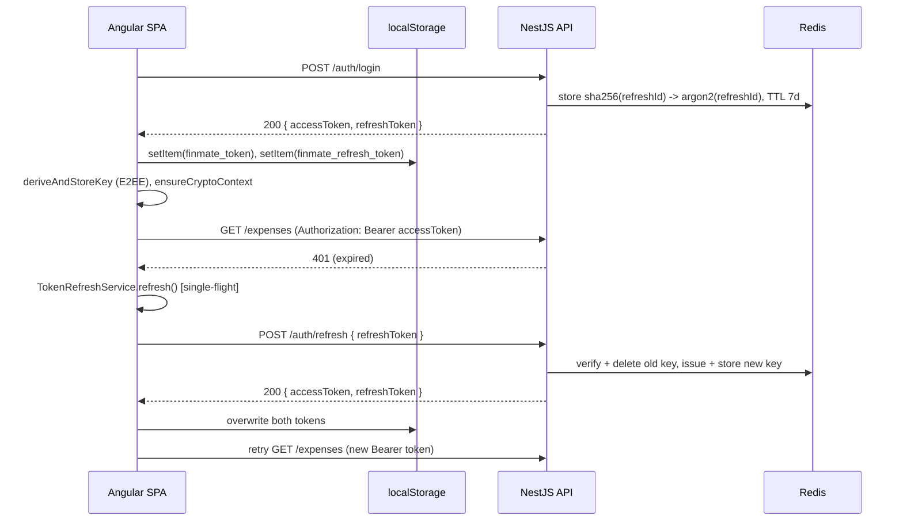
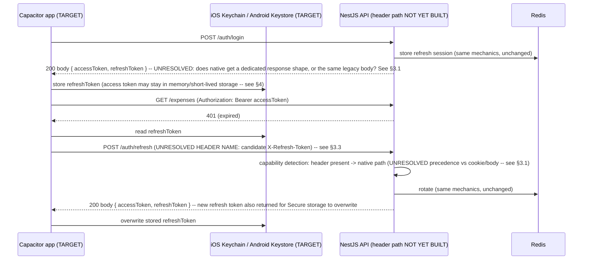

# FinMate - Native Authentication Transport Implementation Specification

**Status:** Specification for a future, explicitly separate implementation
task. **Nature:** Documentation only. This file authorizes no code change,
no feature-flag activation, no dependency installation, no native project
creation, no schema/migration/API change, and no modification to any
accepted ADR or the Decision Ledger. It records engineering design detail
in enough depth that a later, explicitly authorized task can implement it
without re-deriving the architecture — it does not authorize that task to
begin.

**Relationship to prior work:** this document is a companion to
[`FINMATE_MOBILE_CAPACITOR_FUTURE.md`](./FINMATE_MOBILE_CAPACITOR_FUTURE.md)
§15, which already contains the dependency map, readiness matrix, and
sequencing recommendation for `BATCH-06`/`BATCH-14`. **This document does
not repeat that material** — it goes one level deeper, into the exact
flows, contract, and test matrix needed to actually build the native
transport half that §15.1 found has zero code today.

**Unresolved by this document:** which specific header name, precedence
rule, and several other details ADR-013 leaves unspecified. Each is
flagged explicitly in §3/§9 as **[UNRESOLVED — ENGINEERING DECISION]**,
never presented as approved.

---

## 1. Verified Current-State Summary

| Fact | Evidence |
|---|---|
| Both the access token and refresh token are stored in `localStorage` (`finmate_token`, `finmate_refresh_token`) by `AuthState`'s `Login`/`RefreshTokenSuccess` actions and read directly by `jwtInterceptor`/`TokenRefreshService` | `frontend/src/app/core/auth/auth.state.ts` lines 56-58, 99-101, 193-195; `frontend/src/app/core/interceptors/jwt.interceptor.ts` line 16; `frontend/src/app/core/auth/token-refresh.service.ts` line 35 |
| Access token is attached as `Authorization: Bearer <token>` on every outgoing request by `jwtInterceptor`; excluded for `/auth/login`, `/auth/register`, `/auth/refresh` | `jwt.interceptor.ts` lines 14-27 |
| On a 401 (non-auth-endpoint), a single shared refresh request is used across all concurrent callers, then the original request is retried | `jwt.interceptor.ts` lines 29-43; `token-refresh.service.ts` (single-flight `inFlight$`) |
| Refresh tokens are rotated server-side on every use: old Redis key deleted, new one issued, argon2-hashed, 7-day TTL | `backend/src/app/auth/auth.service.ts` `refresh()` lines 466-517 |
| Logout deletes the one active Redis session key for the refresh token used; `revokeAllSessions` deletes all of a user's keys (used by `UsersService.deleteAccount`, verified in prior Account-Ledger work) | `auth.service.ts` lines 526-530, `logout()` line 581+ |
| When `auth.dualTransport` is **ON** (default OFF): login sets `finmate_refresh_token`/`finmate_csrf` HttpOnly cookies in addition to the body; refresh prefers the cookie, validates a CSRF double-submit header, rejects a conflicting body+cookie pair with `AUTH_TOKEN_AMBIGUOUS`, and **omits the refresh token from the response body** on the cookie path; logout clears both cookies | `backend/src/app/auth/auth.controller.ts` lines 141-227; `auth-transport.util.ts` |
| CORS is already configured with `credentials: true` and an env-driven origin allowlist (`CORS_ORIGINS`/`FRONTEND_URL`) — required for any cookie-based cross-origin flow | `backend/src/main.ts` lines 36-41 |
| Login also derives and stores the client-side E2EE master key (`ClientEncryptionService.deriveAndStoreKey`) and initializes the crypto session (`CryptoSessionManager.ensureCryptoContext`); logout tears down the crypto session and clears cached group keys | `auth.state.ts` lines 109-132 (login), 162-167 (logout) — **this coupling must be preserved by any transport change; it is unrelated to which transport carries the token** |
| **No native-header transport code exists anywhere** — confirmed by a repository-wide search for a custom refresh-header read in `auth.controller.ts`/`auth-transport.util.ts` | `FINMATE_MOBILE_CAPACITOR_FUTURE.md` §15.1 |
| Existing test coverage for the cookie/CSRF path is substantial (enumerated in §7) | `auth.controller.spec.ts`, `auth-transport.util.spec.ts`, `token-refresh.service.spec.ts`, `auth-guards.spec.ts` |

---

## 2. Authentication Flow Diagrams

### 2.1 Browser — current legacy path (flag OFF, today's default)



### 2.2 Browser — dual-transport path (flag ON, cookie present)

```mermaid
sequenceDiagram
  participant FE as Angular SPA (TARGET, not yet built)
  participant API as NestJS API (built, flag-gated)
  participant Redis

  FE->>API: POST /auth/login
  API->>Redis: store refresh session (same as 2.1)
  API-->>FE: Set-Cookie finmate_refresh_token (HttpOnly), finmate_csrf (HttpOnly)
  API-->>FE: 200 body { accessToken, refreshToken, csrfToken } (TRANSITION: body still dual-emitted)
  Note over FE: TARGET FE behavior (not yet built): do not persist refreshToken; keep csrfToken for the refresh call

  FE->>API: POST /auth/refresh (Cookie: finmate_refresh_token; X-CSRF-Token: csrfToken)
  API->>API: parseCookies, csrfMatches (constant-time)
  API->>Redis: rotate (same mechanics as 2.1)
  API-->>FE: Set-Cookie finmate_refresh_token (new), finmate_csrf (new)
  API-->>FE: 200 body { accessToken, csrfToken } -- NO refreshToken in body on this path
```

**Note:** the *frontend* half of this path (reading/using the cookie
contract instead of `localStorage`) is **not implemented** — only the
backend emits/accepts it today. This diagram's FE side is target
behavior, explicitly labeled.

### 2.3 Native — target path (ADR-013, zero code exists — this document's main subject)



Every box marked **UNRESOLVED** in §2.3 is a real gap in `ADR-013` as
written — not an oversight of this document. `ADR-013` decides *that*
native uses header+secure-storage; it does not specify the header name,
the exact response shape, or the capability-detection precedence order
when a request carries more than one transport signal.

---

## 3. Native Transport Contract

### 3.1 Capability detection — partially resolved, partially open

**Resolved by `ADR-013` itself:** detection must be by **capability**, not
by platform sniffing (`ADR-013`: "never `if(iOS)`"). The existing cookie
path already establishes the pattern: *presence of a specific signal in
the request* selects the transport, with a defined fallback order.

**[UNRESOLVED — ENGINEERING DECISION]:** the existing fallback order is
`cookie present → cookie path; else → legacy body path`. Adding a native
header introduces a three-way precedence question `ADR-013` does not
answer: if a request somehow carried *both* a cookie and the new header
(should never happen for a correctly-behaving client, but the existing
code already has a precedent for defensively rejecting an analogous
conflict — the `AUTH_TOKEN_AMBIGUOUS` check for cookie vs. body), what
should the server do? **Proposed for review, not approved:** extend the
existing conflict-rejection pattern — reject with a new, equally explicit
error code (e.g. `AUTH_TRANSPORT_AMBIGUOUS`) rather than silently picking
one, consistent with the existing `AUTH_TOKEN_AMBIGUOUS` precedent's own
stated reasoning ("never let two different refresh tokens silently
succeed").

### 3.2 Login request/response behavior

| Aspect | Resolved? | Detail |
|---|---|---|
| Request shape | Resolved (unchanged) | Existing `LoginDto` (email/password/MFA code) — no native-specific login request field is required by anything in `ADR-013` |
| Response shape for a native caller | **[UNRESOLVED]** | `ADR-013` does not say whether native receives a *different* response (e.g., refresh token always present, no cookie set) or the exact same dual-emit body the web client gets today. **Proposed for review:** native requests should receive the refresh token in the body (as today), since there is no cookie to set for them and the client is responsible for moving it into Keychain/Keystore immediately — the server does not need to know "this is a native client" at login time at all, only at *refresh* time (§3.1), which simplifies this half of the contract. |

### 3.3 Refresh-token transport and rotation

| Aspect | Resolved? | Detail |
|---|---|---|
| Rotation mechanics | **Resolved (unchanged)** | Same Redis rotate-on-use mechanism already in `AuthService.refresh()` — `ADR-013`'s decision text explicitly says "Rotation + Redis session hashing retained." No change proposed here. |
| Header name | **[UNRESOLVED]** | Not specified anywhere in `ADR-013`, the execution plan, or any other inspected document. **Candidate only, not approved:** `X-Refresh-Token`. |
| Header vs. body for the *request* | **[UNRESOLVED]** | Whether the native client sends the refresh token via the new header, or continues using the existing request body field (`RefreshTokenDto.refreshToken`) while the *only* thing that changes is where the client *stores* it (Keychain/Keystore instead of `localStorage`). **This second option is simpler and requires zero backend contract change** — only a frontend/native storage change — and should be evaluated first before building new backend header-parsing logic. Flagged as the primary open question this specification surfaces. |
| Access-token transport | **Resolved (unchanged)** | `Authorization: Bearer <accessToken>` on every request, identical to web — `ADR-013` does not propose changing this, only refresh-token transport. |

### 3.4 Logout and credential invalidation

Resolved by extension of the existing pattern: logout must delete the
specific Redis session key for the refresh token presented (unchanged
`AuthService.logout`), and — whichever transport decision in §3.3 is
made — the client must clear the token from wherever it stored it
(Keychain/Keystore) exactly as the web client already clears
`localStorage` today (`AuthState.logout`, lines 169-171). No new backend
behavior is required for logout beyond what §3.3 resolves for refresh.

### 3.5 Unauthorized / expired-session handling

Resolved by extension of the existing pattern: `JwtAuthGuard.handleRequest`
already distinguishes `TokenExpiredError` from "missing token" from a
generic invalid-token case (`jwt-auth.guard.ts` lines 13-24) — this is
platform-agnostic and needs no native-specific change.

### 3.6 Concurrent refresh behavior

Resolved by extension of the existing pattern: `TokenRefreshService`'s
single-flight coordination (`frontend/src/app/core/auth/token-refresh.service.ts`)
is a *client-side* mechanism and is reusable as-is for a native client —
the server-side rotation already assumes "first refresh call wins, second
with the same stale token fails," which is exactly why single-flight
coordination exists. No server change needed for this property.

### 3.7 Secure credential storage requirements

See §4 (dedicated section, per the task's own structure).

### 3.8 Error handling and retry behavior

Resolved by extension: the existing `jwtInterceptor`/`TokenRefreshService`
retry-after-refresh pattern is platform-agnostic Angular code and should
work unmodified for a Capacitor-wrapped app, **provided** the token-read
call sites (`localStorage.getItem` in `jwt.interceptor.ts` line 16 and
`token-refresh.service.ts` line 35) are changed to read from whichever
secure-storage abstraction §4 specifies — this is a **required code
change**, not a gap in the existing design, and is explicitly listed as
the first implementation task in §10.

### 3.9 Compatibility with existing browser clients

**Resolved, already proven by existing tests** (§7): the dual-emit design
already guarantees a browser client that has never heard of cookies keeps
working unmodified (flag-OFF path, or flag-ON with no cookie → body
fallback). Adding a native header transport is additive to this and does
not require any change to the browser path.

### 3.10 Required frontend/backend interfaces

| Interface | Change required |
|---|---|
| Backend: `auth.controller.ts` refresh/login/logout handlers | Extend the existing transport branching (§3.1/§3.3) — **exact shape unresolved, see above** |
| Frontend: a secure-storage abstraction service (does not exist) | New — see §4 |
| Frontend: `jwt.interceptor.ts`, `token-refresh.service.ts` | Change their `localStorage.getItem`/`setItem` calls to the new abstraction — **the only required frontend change on the existing files**, everything else (single-flight logic, retry-on-401) is reusable as-is |
| Frontend: `AuthState` (`auth.state.ts`) | Same storage-call substitution in `login`/`logout`/`refreshTokenSuccess`; **the E2EE key-derivation/crypto-session coupling (§1) must be preserved exactly** |

### 3.11 Does the existing dual-transport implementation weaken security by adding native support?

**No, provided §3.1's capability detection rejects ambiguity rather than
guessing** (the same principle the existing cookie-vs-body code already
follows). CSRF double-submit exists specifically because a browser
auto-attaches cookies cross-origin/same-site; a native app's custom header
is **not** ambiently attached by any OS mechanism the way a cookie is, so
it is **not CSRF-vulnerable in the same way** — **[UNRESOLVED —
ENGINEERING DECISION, but low-risk default]:** the native header path
should not need its own CSRF scheme, by the same reasoning the existing
code already applies to why cookies specifically need CSRF and bodies
don't. This is a recommendation for review, not a decision made here.

---

## 4. Secure-Storage Requirements

| Platform | Access token | Refresh token | Mechanism |
|---|---|---|---|
| Browser (web) | Memory/NGXS state today; **[UNRESOLVED whether this changes]** — `ADR-013` only names the *refresh*-token transport as the target change; it does not propose moving the access token out of `localStorage`/memory | HttpOnly cookie (already built, flag-gated) | Unchanged from the existing dual-emit design |
| Native Android | **[UNRESOLVED]** — not named in `ADR-013` beyond "native secure storage"; access tokens are short-lived and commonly kept in memory on native apps, but this document does not assume that without a decision | Android Keystore, via a Capacitor secure-storage plugin — **[UNRESOLVED — ENGINEERING DECISION: which plugin]**, none evaluated in this repository | `ADR-013` names the mechanism (Keystore), not the plugin |
| Native iOS | Same open question as Android | iOS Keychain, via the same (unselected) plugin | `ADR-013` names the mechanism (Keychain), not the plugin |

| Scenario | Required behavior | Resolved? |
|---|---|---|
| App restart (native) | Refresh token must still be readable from Keychain/Keystore without re-login, exactly as a browser reload reads a still-valid cookie/`localStorage` value today | Architecturally implied by `ADR-013`, not yet implemented |
| Logout | Secure storage entry must be deleted, not merely the in-memory reference | Same pattern as existing `localStorage.removeItem` (§3.4) |
| Token rotation | New refresh token overwrites the old one in secure storage on every successful refresh | Same pattern as existing `localStorage.setItem` overwrite (§3.4/2.1) |
| Session expiration (refresh token itself expired/revoked) | Clear secure storage, redirect to login — identical to today's `Logout` action dispatch on a failed refresh (`token-refresh.service.ts` `catchError`) | Reusable as-is once storage calls are substituted |
| Device migration / reinstall | **[UNRESOLVED]** — not addressed by `ADR-013`. A fresh install has no prior Keychain/Keystore entry (iOS Keychain data *can* survive a reinstall depending on configuration; Android Keystore entries are generally tied to the app's signing key and are lost on uninstall) — this is a genuine platform-behavior difference, not invented here, and needs explicit product/engineering input on whether that's acceptable (user simply logs in again) before implementation |
| Failure to access secure storage (e.g. device policy blocks it) | **Must not fall back to `localStorage`, logs, URLs, or any ordinary persistent web storage** — per this task's explicit constraint. **[UNRESOLVED — ENGINEERING DECISION]:** the correct behavior is presumably to fail the login/refresh and surface an explicit error, forcing re-authentication, rather than silently degrading security — this document recommends that default but does not decide it |
| Biometric authentication | **Not required for every login.** Per `ARCHITECTURE.md`'s own "Future Key Vault Architecture (Roadmap)" framing (verified in the prior mobile-proposal session), biometrics are one *optional* local-unlock factor alongside WebAuthn/PIN for the E2EE key vault — a separate concern from whether the refresh token itself is protected. This document does not conflate the two and does not propose making biometrics mandatory. |

---

## 5. Staged Migration and Rollback Plan

| Stage | Scope | Depends on | Rollback |
|---|---|---|---|
| **A — Backend transport readiness (web)** | Verify the already-coded cookie/CSRF path against prod CORS (the execution plan's own stated condition); no new code | None | Flip `auth.dualTransport` back OFF — additive flag, no data migration |
| **B — Browser compatibility verification** | Run the existing test suite (§7) plus a manual regression pass with the flag ON in a non-prod environment | Stage A | Same as A |
| **C — Native transport design decision** | Resolve §3.1/§3.3's open questions (header name/precedence, or the simpler "same body contract, different client-side storage only" option) | Stage B | n/a — design only, no running system affected |
| **D — Native transport implementation** | Backend changes per Stage C's resolved design (if any backend change is even needed — see §3.3's "simpler option") | Stage C | Revert the specific commit; the flag-gated design means this can ship disabled |
| **E — Secure-storage integration** | Native client: select a plugin (§4), substitute storage calls in `jwt.interceptor.ts`/`token-refresh.service.ts`/`auth.state.ts` (§3.10) | Stage D; native project existing (per the mobile proposal's own readiness matrix) | Revert to `localStorage` calls in the native build only — does not affect the web build |
| **F — Automated tests** | New tests for whatever Stage C/D/E actually build (§7 lists what's missing) | Stages C-E | n/a |
| **G — Staging verification** | Full regression (web + native) in a staging environment | Stage F | n/a |
| **H — Production rollout (if separately authorized later)** | Gradual flag enablement, min-version enforcement, compatibility telemetry | Stage G; `W-MOB-04` (min-version) | Extend dual-emit window (per `ADR-015`) |
| **I — Legacy transport retirement** | Remove body-token emission **only** when all five `ADR-015` conditions hold (§6) | Stage H + §6 fully satisfied | Re-enable body emission (explicitly named in `ADR-015`'s own rollback field) |

**This task does not execute any stage above.** Stages A-C could begin as
verification/design work without touching production; D onward require a
separate, explicitly authorized implementation task.

---

## 6. The Five-Condition Sunset Checklist (verbatim from `ADR-015`, not paraphrased)

`ADR-015` line 4: *"the old refresh-token body path is retained (dual-emit)
until **all** hold: web cookie refresh works, native secure-storage header
refresh works, minimum-supported mobile version is enforced, compatibility
telemetry confirms the old path is unused, and the sunset condition is
met."*

| # | Condition (exact) | Current status |
|---|---|---|
| 1 | Web cookie refresh works | **Built, flag-gated, not yet verified in prod** (§1, §5 Stage A) |
| 2 | Native secure-storage header refresh works | **Not built at all** (§1, §3) |
| 3 | Minimum-supported mobile version is enforced | Not built — no min-version enforcement mechanism was found anywhere in this repository |
| 4 | Compatibility telemetry confirms the old path is unused | Not built — no telemetry for old-path usage was found |
| 5 | The sunset condition is met | **The sunset calendar date is itself an `[ENGINEERING PARAMETER]`, explicitly not yet set** (`ADR-015` line 4, `OQ-17`) |

**Body-token removal (`SEC-003`) is satisfied only at sunset, i.e. only
when all five above are simultaneously true.** `ADR-015`'s own rollback
field: *"Extend dual-emit window / re-enable body emission."*

---

## 7. Test and Acceptance Matrices

### 7.1 Authentication correctness

| Case | Existing test | Status |
|---|---|---|
| Valid login (legacy) | `auth.controller.spec.ts` "login returns body tokens and sets NO cookies" | **Covered** |
| Valid login (cookie) | `auth.controller.spec.ts` "login sets a host-only HttpOnly refresh cookie + CSRF cookie and dual-emits" | **Covered** |
| Invalid credentials | Not located in the inspected files this session | **Gap — verify in `auth.service.spec.ts` before assuming untested** |
| Expired access token | `jwt-auth.guard.ts` branch exists; guard-level unit coverage not confirmed this session | **Partially verified — code path exists, test presence not confirmed** |
| Expired/invalid/revoked refresh token | `auth.service.spec.ts` likely covers this (not re-read line-by-line this session) | **Not independently confirmed — flagged, not claimed** |
| Successful refresh + rotation (legacy body) | `auth.controller.spec.ts` "refresh with a body token returns both tokens in the body" | **Covered** |
| Successful refresh + rotation (cookie) | `auth.controller.spec.ts` "refresh via cookie with a valid CSRF token rotates and returns NO refresh token in the body" | **Covered** |
| Logout + subsequent rejection | `auth.controller.spec.ts` "logout uses the body token and clears no cookies" / "logout reads the cookie token and clears both transport cookies" | **Covered for the logout call itself; subsequent-request-rejection is implied by Redis key deletion, not separately asserted in these tests** |
| **Native login/refresh/logout (any transport)** | **None exist — no native-header code exists to test** | **Missing — new tests required once §3 is resolved** |

### 7.2 Transport security

| Case | Existing test | Status |
|---|---|---|
| Cookie transport, valid CSRF | Covered (above) | **Covered** |
| Missing CSRF header | `auth.controller.spec.ts` "refresh via cookie with a MISSING CSRF header is forbidden" | **Covered** |
| Invalid CSRF header | `auth.controller.spec.ts` "refresh via cookie with an INVALID CSRF header is forbidden" | **Covered** |
| Ambiguous cookie+body conflict | `auth.controller.spec.ts` "refresh rejects conflicting cookie + body tokens (no silent success)" | **Covered** |
| Cookie attribute correctness (HttpOnly/Secure/SameSite/host-only/path-scoped) | `auth-transport.util.spec.ts` "refresh cookie is HttpOnly, Secure, SameSite=Lax, host-only, path-scoped" / same for CSRF cookie | **Covered** |
| CSRF constant-time comparison | `auth-transport.util.spec.ts` "csrfMatches (constant-time double-submit)" | **Covered** |
| CORS behavior for supported origins | `main.ts`'s `enableCors({ credentials: true })` exists; no automated test for the origin allowlist was located this session | **Gap** |
| **Native header transport, any scenario** | **None — no code exists** | **Missing** |
| No tokens in URLs/logs | Not independently verified this session; the Account-Ledger work's `redactSensitiveKeys` finding (verified: no `token`/`refreshtoken`/`accesstoken` key-name coverage gap — those ARE on the redaction list, unlike financial-amount fields) is relevant precedent that tokens specifically are already redaction-covered by key name | **Partially verified via a related finding, not re-confirmed directly this session** |

### 7.3 Reliability

| Case | Existing test | Status |
|---|---|---|
| Concurrent refresh requests | `token-refresh.service.spec.ts` "shares a single refresh request across concurrent callers (no logout storm)" | **Covered (client-side)** |
| Fresh refresh after a prior one completes | `token-refresh.service.spec.ts` "starts a fresh refresh after the previous one completes" | **Covered** |
| Server rejects refresh → logout | `token-refresh.service.spec.ts` "logs out (once) and errors when the server rejects the refresh token" | **Covered** |
| No valid refresh token → immediate logout | `token-refresh.service.spec.ts` "logs out immediately when there is no valid refresh token" | **Covered** |
| Network failure during refresh | Not located this session | **Gap** |
| App restart (native) | N/A — no native build exists | **Missing — new scenario entirely** |
| Secure-storage failure | N/A — no secure storage exists yet | **Missing — new scenario, see §4** |
| Interrupted login/logout | Not located this session | **Gap** |
| Duplicate refresh attempts (server-side: second use of an already-rotated token) | Implied by the Redis delete-on-use mechanism (`auth.service.ts`); a direct test asserting the *second* call with the stale token fails was not independently located this session | **Likely covered by design, not independently confirmed** |
| Recovery from an expired session | `auth-guards.spec.ts` "allows access when access is expired but refresh is valid" (route-guard level) | **Covered at the guard level** |

### 7.4 Compatibility

| Case | Existing test | Status |
|---|---|---|
| Existing browser login/session flows, flag OFF | `auth.controller.spec.ts`'s entire "flag OFF" describe block | **Covered** |
| Existing API clients/automated tests unaffected | Implied by the flag defaulting OFF and the "flag OFF" test block asserting byte-for-byte legacy behavior | **Covered** |
| Native-client authentication contract | **Cannot be tested — contract itself is unresolved (§3)** | **Blocked on §3's design decisions, not a testing gap per se** |
| Feature-flag OFF behavior | Covered (above) | **Covered** |
| Feature-flag ON behavior in a controlled test environment | Covered by the existing "flag ON" describe block; **not yet verified against a real prod-like CORS configuration** (the execution plan's own open condition) | **Partially covered — unit-level yes, environment-level no** |

**No test in any of the four matrices above was executed as part of this
task.** Status columns reflect static inspection of test file contents
(`describe`/`it` names), not an actual test run.

---

## 8. BATCH-06 → BATCH-14 Dependency Table

| Item | Current verified status | Prerequisites | Blocking dependencies | Acceptance criteria | Evidence | Next action |
|---|---|---|---|---|---|---|
| `BATCH-06` backend transport readiness (web cookie) | **Code-complete, tested, flag OFF** | None | Flag flip + prod CORS verification (execution plan's own stated condition) | `auth.dualTransport=ON` passes §7.1-7.4's "flag ON" rows in a prod-like environment | §1, §7 | Flip flag in a non-prod env; run existing suite; verify CORS |
| Native-header transport | **Not started — zero code** | §3's design decisions resolved | Nothing blocks *starting* the design work; implementation blocks on the design being resolved | Server accepts the resolved transport (header or body+storage-only, per §3.3) for a native-identified request | §3, §8 | Resolve §3.1/§3.3's open questions first — this is the actual next task, see §10 |
| Secure credential storage (client-side) | **Not started — no plugin selected, no native project exists** | Native project creation (mobile proposal §15.6); plugin selection (§4) | Both unstarted | Refresh token readable/writable via Keychain/Keystore, not `localStorage`, on a running native build | §4 | Select a Capacitor secure-storage plugin for review before any installation |
| `BATCH-14`/`W-MOB-01` secure storage | **Blocked (native)**, per execution plan | Native-header transport + secure credential storage, both above | Both unstarted | Tokens never touch `localStorage`/WebView JS-accessible storage on native | Mobile proposal §15 | Do not schedule until the two rows above are resolved |
| `W-MOB-02` push notifications | **Blocked**, per `ADR-021` (OS push is TARGET, gated on native push infra) | A native project + a push plugin + vendor (FCM/APNs) registration, none started | `VEN-1` vendor review not started | Content-free push payloads only, per `ADR-021` | Mobile proposal §5 feature #5 | Not this document's scope — unchanged from the mobile proposal |
| `W-MOB-03` deep links | **Not started** | Native project + hosted verification files (`assetlinks.json`/`apple-app-site-association`) | Neither started | Opening a shared link on a device with the app installed opens directly to the target screen | Mobile proposal §5 feature #13 | Not this document's scope |
| `W-MOB-04` minimum supported version | **Not started — no mechanism found anywhere** | None technical | Design decision on enforcement mechanism (header check? app-store-forced-update?) | Old clients below the minimum version are rejected or prompted to update | `ADR-015` condition 3 (§6) | Design needed — not scoped in this document |
| Capacitor project creation (Android) | **Not started** | None technical | Governance-owner approval (per repo convention — never install without telling the user first) | `npx cap add android` succeeds | Mobile proposal §15.6 | Await explicit approval |
| Capacitor project creation (iOS) | **Not started** | macOS/Xcode environment — **not available in this session** | Environment + approval | `npx cap add ios` succeeds on a macOS machine | Mobile proposal §15.6 | Identify macOS/Xcode access before scheduling |
| Android build validation | **Not started** | Project creation above | Same | App builds and launches on an emulator/device | Mobile proposal §15.6 | Blocked on project creation |
| iOS build validation | **Not started** | Project creation above + macOS/Xcode | Same | App builds and launches on a simulator/device | Mobile proposal §15.6 | Blocked on project creation + environment |

**No batch above is marked complete because partial code exists.**
`BATCH-06` is split into its web half (code-complete) and native half (not
started) precisely so this distinction is never collapsed into a single
"BATCH-06 done" claim.

---

## 9. Unresolved Design Decisions (consolidated from §3-§6)

1. **Capability-detection precedence** when more than one transport signal could theoretically be present (§3.1).
2. **Exact native refresh-token header name**, if a header is even the chosen mechanism (§3.3) — candidate `X-Refresh-Token` only, not approved.
3. **Whether the backend contract needs to change for native at all**, versus the simpler option of keeping the existing body contract and only changing *client-side storage location* (§3.3) — this is the single highest-leverage open question, since resolving it toward "no backend change" would shrink this entire specification's implementation cost substantially.
4. **Whether a native-specific login response shape is needed** (§3.2).
5. **Whether the native header path needs its own CSRF-equivalent scheme** (§3.11) — recommended default: no, but not decided.
6. **Which Capacitor secure-storage plugin to use** (§4) — none evaluated.
7. **Whether the access token's storage location changes on native** (§4) — `ADR-013` is silent on this; it only names the refresh token's transport as the target change.
8. **Device migration/reinstall behavior** (§4) — genuine platform-behavior difference, not a FinMate choice alone, needs explicit product sign-off.
9. **Secure-storage failure behavior** (§4) — recommended default: fail closed and force re-authentication, not decided.
10. **Minimum-version enforcement mechanism** (§8, `W-MOB-04`) — not designed at all yet.
11. **Compatibility-telemetry design** (`ADR-015` condition 4) — not designed at all yet.
12. **The sunset calendar date itself** — explicitly an open `[ENGINEERING PARAMETER]` per `ADR-015`/`OQ-17`.

---

## 10. Exact Next Implementation Task and Its Prerequisites

**The next task is not "build BATCH-14."** It is narrower:

> **Resolve unresolved decision #3 above** (§9): determine whether native
> secure-storage support requires any backend contract change at all, or
> whether the refresh token can continue traveling in the existing request
> body — with the *only* required change being where the native client
> stores it (Keychain/Keystore instead of `localStorage`) and the fact that
> it is read from/written to that store instead.

**Why this is the correct next task, not a larger one:** if the simpler
option resolves favorably, the entire native-header design in §3.1/§3.3
becomes unnecessary, and the actual implementation work shrinks to a
frontend-only change (substituting storage calls per §3.10) plus native
project creation and plugin selection — with **zero backend code change**
to `auth.controller.ts`. This should be decided **before** any backend
work is scoped, to avoid building unneeded header-parsing logic.

**Prerequisites for that decision task:**
- No native project needs to exist yet to make this decision — it is a design review, not an implementation.
- Requires engineering judgment on whether "capability detection" in `ADR-013`'s text was intended to require a *new* signal (a header) or was describing the existing body-vs-cookie distinction extended to a third client type that simply never sends a cookie.
- Does not require governance-owner approval to *discuss*; would require it before implementing either resolution.

**Prerequisites for the implementation task that follows that decision:**
- The decision above, recorded.
- A selected secure-storage Capacitor plugin (§4, #6).
- An approved native project (§8) — or, if the decision in §10 resolves to "frontend-only," the storage-substitution code could in principle be written and tested with a plugin stub before a full native project exists, though it cannot be verified end-to-end without one.

---

## 11. Final Reconciliation

- **CURRENT:** the web-cookie half of `BATCH-06` is fully built and tested behind a flag; the native-header half has no code; no secure-storage mechanism, plugin, or native project exists; the E2EE login/logout coupling in `AuthState` is real and must be preserved by any transport change.
- **TARGET (per `ADR-013`/`ADR-015`, not modified by this document):** native uses Keychain/Keystore via a header-based (or possibly body-based, per §9 #3) transport, capability-detected, with the existing rotation/revocation mechanics unchanged, under a five-condition dual-emit sunset.
- **Not changed by this document:** any application code, feature flag, dependency, native project, schema, migration, API, accepted ADR, or the Decision Ledger. The Account/Balance Ledger gates (`ACC-2a`, `ACC-4`, `ACC-5`, `ACC-6`, `ACC-2b`) are untouched and unaffected.

**One-line status:** Implementation-ready specification with explicitly
flagged open design decisions; no implementation authorized by this
document.
